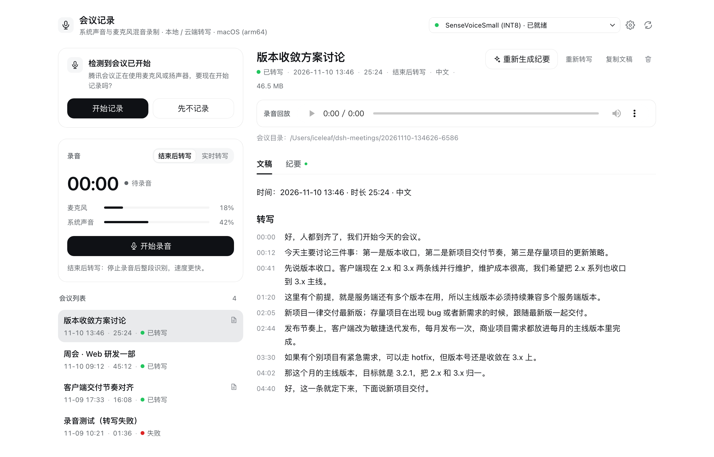

# 会议记录 · 本地录音与转写

一个 DSH Web 插件：左侧栏「会议记录」入口，把「系统声音 + 麦克风」混音录下来，用本地语音识别模型（默认 SenseVoiceSmall，也可切换本插件自带的 Qwen3-ASR）或硅基流动云端模型转成中文文稿（可夹少量英文），需要时一键把转写交给 DSH 大模型整理成会议纪要，并在左侧工作区生成一条可继续聊天的会话记录。



当前版本：**v0.7.2**（详见 [CHANGELOG.md](CHANGELOG.md)）；npm 包：`@iceleaf/dsh-meeting-notes`。

## 功能

- 侧栏入口「会议记录」，主页面完成录音、转写、文稿查看与纪要生成；左侧窄栏是录音与会议列表，右侧是文稿/纪要阅读区，设置项收进右上角齿轮打开的独立弹窗。
- 录音默认同时采集**系统音频**与**麦克风**，逐样本相加混音，输出 16kHz 单声道 PCM：macOS 走 ScreenCaptureKit + AVAudioEngine，Linux 走 PipeWire / PulseAudio 的 monitor 源与默认输入源。
- 两种转写模式：
  - **录音结束后转写**（默认）：停止后后台整段转写，录音期间同时预热本地模型；
  - **实时转写**：录音中按静音点自动切段识别，边说边出字。
- 识别默认由本插件自带的两个本地引擎完成，**不依赖 DSH 的语音输入插件**，完全本机离线、不联网；也可以切换到硅基流动的云端模型（需要 API 密钥，音频会上传到硅基流动）。本地模型首次使用前需下载到本机，下载、取消与模型切换都在设置页「识别模型」的下拉与详情卡里完成。
- 自带两个本地模型与一个云端模型：
  - **SenseVoiceSmall (INT8)**：本插件自带 provider（`sensevoice.js` + `asr-worker.js`），支持实时转写，速度快；默认复用 DSH 语音插件已下载的模型目录（若存在），避免重复下载约 230 MB 的模型文件；
  - **Qwen3-ASR-0.6B (INT8)**：本插件自带 provider（`qwen3.js` + `asr-worker.js`，依赖 `sherpa-onnx-node`），约 1.15 GB，中文/方言/中英混说更稳，但非流式、单次窗口约 30 秒，更适合「结束后转写」；
  - **XingChenASR-V3.2-Ultra（硅基流动云端）**：本插件自带 provider（`xingchen.js`），把切好的音频上传到硅基流动转写，中/英/方言混说更稳，**无需下载模型**；需要 API 密钥（直接在该模型详情卡里填写，或环境变量 `SILICONFLOW_API_KEY`），当前该模型免费；非流式、单段上限 50 MB，**不建议开启实时转写**。
- 模型下拉按 provider 动态生成：DSH 语音输入插件启用时，它的 provider 会作为额外来源合并进下拉并标注「插件自带」/「DSH 语音插件」；选中某个模型即可下载、切换与查看准备进度。
- 语言默认 `zh`，中文为主；SenseVoice 自带中英混说能力，英文术语、产品名会原样保留；云端模型只看 `auto` / `zh` / `en` / `yue`（模型自身按中英与方言自动判断，方言语音输出标准中文）。
- **会议提醒**（macOS 14.2+ / Linux，默认开启）：后台检测腾讯会议、企业微信内置会议是否真的开始/结束（只看它们对麦克风、扬声器的占用状态，不读音频内容、不自动录音）；开始时页面内弹出「要开始记录吗」建议，结束时弹出「要结束记录吗」建议，同时以 **DeepSeek Harness** 身份发一条系统通知。同意即执行，忽略或超时后 30 分钟内不再打扰。检测订阅常驻在插件启动作用域，只要 DSH 在运行（页面可最小化、可在其他对话）就会提醒。
- 音频与文稿默认存 `~/dsh-meetings/`，可在界面里换目录；每个会议一个目录，结构见下。
- 文稿按「时间戳 + 文本」逐段保存，音频可在页面内直接播放（支持 Range）。
- 「生成会议纪要」不是默认行为：点按钮才把会议目录注册成 DSH 工作区、建一条会话并发送纪要 prompt；模型读 `transcript.md`、写 `minutes.md`，客户端跳到该会话，后续可在同一会话里继续追问与修改。
- 平台：录制与会议检测已实现 **macOS 与 Linux**（Linux 需要 PipeWire 或 PulseAudio 及 `pactl` / `parec`，即 `pulseaudio-utils`）；Windows 上会明确提示「暂不支持」。存储、转写、纪要等其余能力与平台无关。

## 依赖

- DSH（Web profile），Host 需要 `webServer` 服务；纪要功能需要 `workspaceRegistry` 与 `sessionController` 服务（Desktop 版默认都有）。
- 本地识别不依赖任何 DSH 可选插件：两个引擎（SenseVoice / Qwen3-ASR）都由本插件自带，模型用 `sherpa-onnx-node`（`^2.0.1`，含 macOS arm64、Linux x64 / arm64 的预编译 ONNX 运行时）在本机推理。
- 云端识别只依赖网络与硅基流动 API 密钥（`https://api.siliconflow.cn/v1`），不需要 `sherpa-onnx-node`、不下载模型；单段音频上限 50 MB / 约 1 小时，本插件按 50 秒切块。
- SenseVoice 模型默认放在 `~/.dsh/speech-to-text/sensevoice/models/sensevoice-onnx/`（复用 DSH 语音插件已下载的目录；可用 `sensevoiceModelDir` 配置覆盖），下载源为 Hugging Face / HF-Mirror，文件锁定上游 commit 与 sha256；Qwen3-ASR 模型放在 `~/.dsh/speech-to-text/qwen3-asr-0.6b/`（可用 `qwen3ModelDir` 配置覆盖），下载源为 ModelScope（国内推荐）或 HF-Mirror。
- DSH 语音输入插件不是必需项：启用后它的 provider 会作为额外来源合并进模型下拉，供已有用户复用；停用时模型下拉仍由插件自带引擎填充。
- 录制：macOS 需要 13+（ScreenCaptureKit 音频采集）；Linux 需要 PipeWire 或 PulseAudio，以及 `pactl` / `parec`（Debian / UOS 上由 `pulseaudio-utils` 提供）。会议检测：macOS 需要 14.2+（CoreAudio 进程对象 API）；Linux 用 `ps` 与 `pactl`，不需要额外权限，也不依赖 X11 窗口标题，Wayland 下可用。
- macOS 首次使用由插件调用 `swiftc` 编译 `recorder/`（Xcode Command Line Tools，约 10–30 秒）；Linux 不需要编译，直接调用系统的 `parec`。
- 会议检测不读音频内容、不截屏：macOS 上不需要 TCC 权限，Linux 上只读取进程名与 PulseAudio 的流元数据。系统通知复用 DeepSeek Harness 的通知授权，首次发通知时系统会询问是否允许。
- 系统权限：macOS 需要**屏幕录制**（采系统声音）与**麦克风**，授予对象是 DeepSeek Harness，未授权时页面会给出中文提示；Linux 不需要额外授权，只要默认扬声器与麦克风可用即可。
- 运行时依赖只有 `sherpa-onnx-node`（两个自带引擎共用的 ONNX 运行时）；客户端只用 React（由 DSH 模块表提供）与浏览器 `fetch` / `ReadableStream`，无构建步骤、无数据库。

## 安装

从 npm 安装（推荐）：

```bash
dsh plugin --profile web add @iceleaf/dsh-meeting-notes
# Desktop 版把 web 换成 desktop
```

装完重启 DSH（或刷新页面），左侧栏出现「会议记录」。macOS 首次录音会自动调用 `swiftc` 编译辅助程序（需 Xcode Command Line Tools）；Linux 直接使用系统的 `parec`。首次识别需在设置页「识别模型」下拉里选中模型并下载；用云端模型则在该模型详情卡里填硅基流动 API 密钥（或设 `SILICONFLOW_API_KEY` 环境变量），无需下载。

Linux 上若提示缺少 `pactl` / `parec`，安装系统包即可（Debian / UOS）：

```bash
sudo apt install pulseaudio-utils
```

本地开发：

```bash
git clone https://github.com/iceleaf916/dsh-meeting-notes.git
cd dsh-meeting-notes && npm install   # sherpa-onnx-node + 测试用的 react/jsdom
```

然后在 DSH 里把仓库目录装成本地 bundle（Plugin Manager 选目录，或让 Agent 执行 `plugin_manager install_bundle`，目标是该目录绝对路径），刷新页面后从左侧「会议记录」进入。

macOS 首次录音会自动编译辅助程序（Linux 无需编译）；首次识别若模型未就绪，打开设置页「识别模型」，从下拉里选中该模型后点「下载并准备」，选择下载源（自动 / ModelScope / Hugging Face / HF-Mirror）后等待进度完成即可。Qwen3-ASR 首次下载约 1.15 GB，SenseVoice 约 230 MB；ModelScope 在国内通常比 Hugging Face 快一个数量级。

## 存储结构

默认 `~/dsh-meetings/<会议编号>/`，会议编号形如 `20261110-140322-a1b2`（本地时间 + 4 位随机十六进制）：

| 文件 | 内容 |
|---|---|
| `meeting.json` | 会议元信息与分段转写结果（标题、时间、时长、模式、语言、状态、segments） |
| `audio.wav` | 16kHz 单声道 s16le 录音 |
| `transcript.md` | 带时间戳的转写文稿（`[00:01:23] 文本`） |
| `minutes.md` | 模型生成的会议纪要（只有点过「生成会议纪要」才有） |

同一个存储目录在 DSH 里对应唯一一个「会议记录」工作区，重复点「生成纪要」不会产生重复工作区，每次都会新建一条会话记录。

## 实现说明

### 录音（`capture.js` + `capture-linux.js` + `recorder/`）

Host 侧对上层只暴露 `platformInfo()` / `recorderState()` / `ensureRecorder()` / `startRecorder()` 四个入口，内部按 `process.platform` 分派：

- **macOS**：`recorder/main.swift` 是独立 CLI（`--sample-rate 16000 --system 1 --mic 1`）。系统音频走 ScreenCaptureKit（`SCStreamConfiguration.capturesAudio`），麦克风走 `AVAudioEngine` 的 inputNode tap；两路降混单声道后相加 clamp 到 `[-1,1]`，重采样到 16kHz，s16le 裸 PCM 写 stdout。stderr 每行一个 JSON 事件（`ready` / `level` / `error` / `stopped`）。首次使用或源码更新后由 `capture.js` 调 `build.sh` 编译到 `recorder/.build/`，并发调用合并为一次构建。
- **Linux**：`capture-linux.js` 先读 `pactl get-default-sink` / `get-default-source`，用 `pactl list short sources` 校验设备名后，为「默认 sink 的 `.monitor` 源」和「默认输入源」各起一个 `parec --format=s16le --rate=16000 --channels=1 --raw --latency-msec=20` 子进程。PipeWire 的 pulse 兼容层对不存在的源名会永久阻塞，所以设备名必须先校验。两路 PCM 由 `PcmMixer` 混音：用「首块数据的到达时间 − 该块时长」估算每路内容起点，晚开始的流补静音对齐，每 20ms 按绝对时间轴取样本、逐样本相加并 clamp 到 int16；积压超过 1 秒直接丢弃，避免延迟越滚越大。每 100ms 发一次合并电平。`DSH_MEETING_SYSTEM_SOURCE` / `DSH_MEETING_MIC_SOURCE` 可覆盖设备名，便于把会议应用固定到某个 sink 的场景。
- 两个平台的 `startRecorder()` 返回同一形状的句柄（`ready` / `stop()` / `kill()` / `child`），`stop()` 会先把已到的 PCM 全部发出再 resolve，Host 之后才关闭 WAV。Linux 句柄的 `child` 是带 `stdin` / `stdout` / `stderr` / `pid` / `kill` 的门面对象，用来兼容 Host 侧对子进程的统一处理。
- 之所以 macOS 不用 CoreAudio process tap：本机实测 `AudioHardwareCreateProcessTap` + aggregate device 创建与启动都返回成功，但 IOProc 回调永远是 0 帧；ScreenCaptureKit 稳定可用。Linux 没有等价的单进程采集接口，直接采 sink monitor 更通用。Windows（WASAPI loopback）仍需补一层。

### 会议检测与提醒（`detector.js` + `detect-linux.js` / `recorder/detector.swift` + `detect.js`）

- Linux 由 `detect-linux.js` 采样：用 `ps -eo pid=,comm=` 找会议客户端进程（腾讯会议 `wemeetapp` / `wemeet`，企业微信会议 `wwmapp` / `wxwork` 等，按进程名精确匹配，避免把企业微信目录里的 `wemeet.dll` 当成腾讯会议），再读 `pactl -f json list sink-inputs` 与 `source-outputs`（JSON 不可用时回退解析文本），按 `application.name` / `application.process.binary` / `media.name` / `node.name` 判断该进程此刻是否在放音或收音；名字或描述里带 `wemeet` 的专用 sink 也算腾讯会议在会中。只有进程在跑才输出样本，采样格式与 macOS 检测器一致，`detect.js` 完全复用。它不依赖 X11 窗口标题，纯 Wayland 也能工作。
- 腾讯会议没有可供第三方使用的本地会议事件（AppleScript 字典、URL scheme 回调都没有；企业 API 的会议事件只覆盖 Rooms/CSAPI 创建的会议且要 OAuth），所以检测只能观察系统侧痕迹。选定的主信号是 **CoreAudio 进程对象**（macOS 14.2+）：`kAudioHardwarePropertyProcessObjectList` 枚举音频进程，`kAudioProcessPropertyIsRunningInput/Output` 判断「腾讯会议的进程此刻是否真的在采麦克风 / 放音频」。它回答的正是「在会中」这件事本身，而且**不需要任何权限**；窗口列表（`CGWindowListCopyWindowInfo`，不需要屏幕录制）只作诊断辅助，不参与结束判定（会议结束后主窗口可能还开着）。
- `recorder/detector.swift` 是独立常驻 CLI：每 500ms 采样一次，命中目标 bundle（腾讯会议 `com.tencent.meeting*` / `com.tencent.wemeet*`，企业微信内置会议 `com.tencent.wwmapp`）的进程按 `{pid,bundle,executable,input,output,window}` 写一行 JSON 到 stderr（stdout 保持为空），`ready` / `sample` / `error` 三种事件；stdin `{"cmd":"stop"}`、SIGTERM/SIGINT 均优雅退出。企业微信会议跑在独立子进程 `wwmapp`（进程名「企业微信·会议」）里，匹配企业微信主进程是抓不到的；`detect.js` 再按 bundle 把客户端映射成「腾讯会议」/「企业微信会议」用于卡片与通知文案。低版本系统发 `error` 后退出，Host 侧降级为「不提示」。
- `detector.js` 与 `capture.js` 同构：首次使用 `ensureDetector()` 编译、并发合并、失败带 stderr 尾部；`startDetector()` 消费 JSONL，`stop()` 走「stdin 优雅停 → 2s SIGTERM → 2s SIGKILL」。
- `detect.js` 是纯状态机 + 提醒控制器：音频持续 **2s** 才判开始，音频消失持续 **12s** 才判结束（切歌、短暂静音不误判）；开始时生成 10 分钟有效的「开始记录」建议，结束时只在录音中生成 5 分钟有效的「结束记录」建议；被忽略/过期后冷却 **30 分钟**。用户同意时直接调用已有的 `startRecording()` / `stopRecording()`，手动开始/停止也会清掉过时建议。检测进程异常退出会以 5s 间隔最多重启 3 次。
- 客户端：rail 顶部渲染建议卡片（主按钮同意、次按钮忽略），并把 `/detect/events` 作为常开 SSE 接收状态变化——订阅挂在插件启动作用域，不随「会议记录」页面卸载而断开；系统通知用渲染进程的 `new Notification('DeepSeek Harness', …)`，点击回到页面并把卡片滚到可视区。平台限制：这种通知没有并排双按钮（macOS 只把第一个 action 当主按钮，其余折叠进 hover 的「选项」），所以 MVP 选「通知叫醒 + 页内卡片二选一」，不用 helper App 伪造按钮（那需要 Developer ID 签名与公证，身份也会变成 helper 自己）。设置页「会议提醒」分组提供「发送测试通知」，用于确认当前环境是否真的展示系统通知。
- 相关配置：`detectEnabled`（默认 `true`）、`detectNotify`（默认 `true`）可在设置页「会议提醒」分组里改；`detectStartSustainSeconds`（2）、`detectEndGraceSeconds`（12）、`detectCooldownMinutes`（30）只在配置层可调。

### 转写（`asr.js`）

- `asr-registry.js` 是模型列表与推理的单一来源：它把插件自带的 SenseVoice / Qwen3-ASR 两个 provider 与可选的 `ctx.speechToText` 服务合并成与 DSH 语音服务同形状的接口（`listProviders` / `snapshot` / `prepare` / `cancelPreparation` / `resolve` / `transcribe`），每行标注 `source: 'plugin' | 'dsh'`；DSH 语音插件启用时把同一个 Qwen3 实例注册进去共享（注销不会 dispose 插件自己的实例），未启用时全部走自带实现，接口行为一致。
- `snapshot()` 生成设置页模型列表（`/state.models`：名称、来源、下载源、磁盘/内存估算、准备阶段与步骤、下载进度）；`listProviders()` 找本地 provider（配置的 id 优先，其次名字含 sensevoice，再次第一个 `host-local`），未就绪时 `prepare(providerId, { downloadSource })` 并在后台轮询到 `ready`；自带 provider 的准备状态由它自己的 `preparation` 提供，DSH provider 走 `service.prepare`。
- 初始化失败不会让列表消失：某个引擎启动失败时仍以 `phase: 'failed'` 的占位行显示原因，另一引擎照常可用；`/state.models` 恒非空。
- 输入必须是 WAV（16k mono s16le），provider 单次上限 4MB（约 128 秒），因此录音结束后按**最小能量点**切块（默认 25 秒左右，3–50 秒区间），逐块 `resolve` + `transcribe`，拼回带时间偏移的 segments。
- 实时模式用 `RealtimeSegmenter` 维护 20ms 帧缓冲：攒够 `chunkSeconds` 或尾部 0.6 秒明显安静就切一段转写；另每 3.5 秒用缓冲区做一次「预览识别」实现边说边出字（预览不消费缓冲，正式分段会再转一次）。
- 识别结果为空的分段直接丢弃，避免文稿里出现大量空行。
- provider 可带 `maxChunkSeconds` 扩展字段约束切块长度：Qwen3-ASR 单次推理窗口约 30 秒，超过会输出乱码，因此切块与该 provider 的实时分段都会压到 30 秒内。

### 自带 provider 与运行时（`sensevoice.js` / `qwen3.js` / `model-runtime.js`）

- 两个引擎共享 `model-runtime.js`：多源下载（`.part` 临时文件、大小与 sha256 校验、失败归类并切换下载源）、准备状态机（`check` / `model` / `verify` / `load`、进度节流、取消）、worker 生命周期（空闲 300 秒释放回 `standby`），以及给 DSH 服务用的 provider 形状（`info` / `preparation` / `transcribe` / `dispose`）。
- 推理放在 `worker_threads` 里（`asr-worker.js` 用 `sherpa-onnx-node` 的 `OfflineRecognizer`），主进程只做 WAV 解析与队列，避免几秒级推理卡住 DSH UI 和 HTTP 接口；SenseVoice 用 `modelConfig.senseVoice`（language 固定 `auto` + ITN，避免按会议语言反复重载），Qwen3 用离线 transducer 配置。

### Qwen3-ASR provider（`qwen3.js` + `asr-worker.js`）

- provider id `qwen3-asr-0.6b`，与本插件自带的 SenseVoice provider 并列出现在模型下拉；DSH 语音输入插件启用时额外注册进 `ctx.speechToText` 供其复用，仅共享、不依赖。
- 模型推理放在 `worker_threads` 里（`asr-worker.js` 用 `sherpa-onnx-node` 的 `OfflineRecognizer`），主进程只做 WAV 解析与队列，避免几秒级推理卡住 DSH UI 和 HTTP 接口；空闲 300 秒后释放 worker 回到 `standby`，录音时自动重新加载。
- 下载：6 个文件顺序下载（conv_frontend / encoder / decoder / tokenizer 六个小文件），已有同尺寸文件直接复用，写 `.part` 临时文件后原子改名；失败按 DNS / 超时 / 证书 / HTTP / 完整性 / 磁盘归类，并自动切换下一个下载源。
- 准备状态与 DSH 内置 provider 保持同一形状（`phase` / `steps` / `download` / `completedBytes` / `totalBytes`），所以设置页模型下拉与进度条无需为该模型特殊处理。
- 语言集合 `auto/zh/en/yue/ja/ko`；本插件在 UI 上标注「实时转写延迟较高」，建议配合「结束后转写」使用。

### 云端 provider（`xingchen.js`）

- provider id `xingchen-asr`，`location: 'cloud'`，与其他模型并列出现在设置页；不需要下载与准备，`preparation` 只看有没有密钥：有则 `ready`，没有则 `unprepare` 并在详情卡提示「未配置硅基流动 API 密钥」。
- 密钥输入框就在云端模型行内（「未配置密钥」提示下方），保存设置时随 `/config` 提交；密钥优先取插件配置 `siliconflowApiKey`，为空时回退 `SILICONFLOW_API_KEY` 环境变量；只存在 Host 侧配置里，不写进 meeting.json，也不回显到 `/state` 以外的日志。
- 转写走 `POST {baseUrl}/audio/transcriptions`（默认 `https://api.siliconflow.cn/v1`），multipart 只带 `file` 与 `model`（接口未公开 `language` 参数，模型自动判断中英与方言）；返回 `{ duration, text }`，`audioSeconds` 优先用 `duration`。
- 错误按状态码归类为「密钥无效 / 余额不足 / 接口或模型不存在 / 请求过于频繁 / 服务不可用 / 网络错误 / 超时」，可重试的错误自动重试一次（间隔 800ms）；取消（AbortSignal）不重试。
- 单段上限 `maxChunkSeconds: 50`（与 `asr.js` 的硬上限一致），`realtime: false`：录音中的实时分段延迟高、且会重复上传，设置页与录音页都会提示**不建议开启实时转写**，建议用默认的「录音结束后转写」。

### 纪要（`minutes.js`）

点击「生成会议纪要」时 Host 侧执行：

1. `workspaceRegistry.create(storageDir, '会议记录')`：把会议存储目录注册成 DSH 工作区（同路径幂等）；
2. `sessionController.create({ workspaceId })`：建一条会话记录（DSH 不接受 `workspaceId` 与 `cwd` 同时给出，会话工作目录即工作区目录）；
3. `sessionController.rename`：标题改为 `纪要 · <会议标题>`；
4. `sessionController.prompt`：排队一条纪要 prompt，要求模型读 `<会议编号>/transcript.md`、写 `<会议编号>/minutes.md`，并在回复里给出纪要全文。

客户端拿到 `sessionId` 后用 `uiWorkspace.openSession(sessionId)` 跳转，用户可以直接在该会话里继续追问；纪要文件的写入由模型完成，Host 不覆盖。

## HTTP 接口

所有接口在 `/dsh-meeting-notes` 下；非 GET 请求必须带 `x-dsh-meeting-notes: 1`，且 Origin 必须是本机 DSH 页面。

| 方法 | 路径 | 说明 |
|---|---|---|
| GET | `/state` | 平台、配置、存储、识别模型列表与准备进度、录音状态、会议列表 |
| POST | `/config` | 保存配置（storageDir / transcribeMode / language / providerId / siliconflowApiKey / captureSystemAudio / captureMicrophone / chunkSeconds / detectEnabled / detectNotify / detectStartSustainSeconds / detectEndGraceSeconds / detectCooldownMinutes） |
| POST | `/prepare` | 准备指定模型（body：`{ providerId?, downloadSource? }`，为空时用当前配置的模型） |
| POST | `/prepare/cancel` | 取消模型准备（body：`{ providerId }`） |
| POST | `/recordings` | 开始录音（body：`{ title?, mode? }`） |
| POST | `/recordings/stop` | 停止并落盘（`after` 模式转写在后台继续） |
| POST | `/recordings/cancel` | 放弃录音并删除本次目录 |
| GET | `/recordings/events` | SSE：`state` / `level` / `partial` / `segment` / `error` |
| GET | `/detect` | 会议检测快照（是否运行、是否在会中、建议卡片、冷却时间） |
| POST | `/detect/ack` | 处理会议建议（body：`{ id, accept }`；接受时直接开始/结束录音） |
| GET | `/detect/events` | SSE：检测状态与建议变化（`detect`） |
| GET | `/meetings/<id>` | 会议详情 + `transcript.md` + `minutes.md` |
| GET | `/meetings/<id>/audio` | WAV 音频，支持 Range |
| POST | `/meetings/<id>/transcribe` | 重新转写 |
| POST | `/meetings/<id>/minutes` | 生成纪要工作区记录 |
| DELETE | `/meetings/<id>` | 删除会议目录 |

## 已知限制

- 采集后端已实现 macOS 与 Linux；Windows（WASAPI loopback）仍需补对应实现。Linux 上系统声音取自**默认 sink 的 monitor**：如果会议应用把声音输出到别的 sink，需要在系统设置里切默认输出，或用 `DSH_MEETING_SYSTEM_SOURCE` 指定该 sink 的 `.monitor` 源。
- 两个本地识别引擎都由本插件自带，不依赖 DSH 语音输入插件；但本地模型仍需下载到本机（SenseVoice 约 230 MB，Qwen3-ASR 约 1.15 GB）。DSH 语音插件启用时其模型会合并进列表，属于可选增强。
- 云端模型需要联网与有效密钥：音频会按 50 秒切块上传到硅基流动；识别效果与配额由服务方决定，插件只做切块、上传与错误提示。云端模型不接受 `ja` / `ko`，切到云端时客户端会自动把语言改为 `auto`。
- SenseVoice 对专业术语、远场小音量识别率有限；实时预览会比正式分段粗糙。
- 生成纪要的时间取决于模型响应，页面只负责跳转到会话，不等待模型写完 `minutes.md`。
- 会议检测支持 macOS 14.2+ 与 Linux（需要 `pactl`）。它依赖「会议客户端在占用音频」这一近似信号（腾讯会议、企业微信内置会议）：如果会议中双方长时间完全静音、或系统音频没有实际音频流，开始/结束判定可能延迟。Linux 上还依赖「进程名 + PulseAudio 流」的组合，进程名被改写或客户端使用非标准二进制名时可能漏检；macOS 检测进程首次使用需编译，前几秒不可用，Linux 无编译步骤。
- 系统通知的身份与按钮受平台限制：Desktop 版以 DeepSeek Harness 身份弹出，但只能点击回到页面（页内卡片完成二选一）；Web profile 在浏览器里打开时身份是浏览器本身，需要单独授权通知。
- 系统通知由客户端插件常驻发出：只要 DSH 在运行（页面最小化、切到其他对话都可以）就会提醒；DSH 完全退出后不会提醒。Desktop 版渲染进程通知是否进入系统通知中心取决于运行环境，设置页可用「发送测试通知」自检；若看不到，说明该环境不展示渲染进程通知，需要 helper App 或 DSH 上游通知服务（本版未做）。

## 开发

- `recorder/test.sh`：macOS 录音辅助程序自测（参数校验 / 混音采样 / EOF / SIGINT）。
- `test/smoke.mjs`：客户端 UI 冒烟（真实 React + jsdom，stub fetch，覆盖首屏、开始录音、生成纪要跳转、设置弹窗与标签切换）。
- `test/models.mjs`：设置页与顶栏模型下拉交互（状态文案、详情卡、切换模型、下载进度、取消准备）。
- `test/xingchen.mjs`：硅基流动云端 provider 纯逻辑测试（元数据、无密钥状态、multipart 字段、时长回退、错误归类与重试、取消不重试），不联网。
- `test/qwen3.mjs`：Qwen3 provider 纯逻辑测试（WAV 解析、切块上限、下载错误归类、provider 元数据与未准备状态），不联网、不加载模型。
- `test/registry.mjs`：ASR 门面纯逻辑测试（自带 / DSH provider 合并去重与来源标注、resolve / transcribe / prepare / cancel 路由、失败占位、DSH 未启用时的选择回退）。
- `test/sensevoice.mjs`：SenseVoice provider 元数据与资源锁测试（provider info、上游 commit 与 sha256、默认模型目录、sherpa-onnx 配置），不联网、不加载模型。
- `test/linux.test.mjs`：Linux 采集与检测测试（混音对齐与截断、电平、`pactl` 解析、设备解析、检测采样契约与幂等停止），不需要真实声卡；没有 `pactl` 时检测用例自动跳过。
- `test/detect.test.mjs`：会议检测纯逻辑测试（状态机去抖/宽限/只听、建议生成与过期、接受即开始/结束录音、忽略冷却、配置关闭不启动、去抖参数热更新），不编译 Swift、不弹通知。
- UI 测试都从仓库根目录解析 `react` / `react-dom` / `jsdom`，直接 `node test/smoke.mjs`、`node test/models.mjs`、`node test/qwen3.mjs`、`node test/xingchen.mjs`、`node test/registry.mjs`、`node test/sensevoice.mjs`、`node test/linux.test.mjs` 运行。
- `test/preview.mjs`：视觉预览（同一套 jsdom + 真实 React，把主界面几个状态渲染成静态 HTML 到 `/tmp/mn-preview`，再用无头 Chrome 截图；需带 `--virtual-time-budget` 等动画结束）。
- `assets/screenshot-main.png`（README 主截图）就是这套预览渲染出来的：`cd test && node preview.mjs /tmp/mn-shot`，再对 `main-transcript-light.html` 用 `--force-device-scale-factor=2 --window-size=1280,820` 截图。改 UI 后同步重截，不要手改图片。

## 许可

[MIT](LICENSE)；音频格式与 ONNX 运行时由 DSH 侧或 `sherpa-onnx-node` 提供（macOS 与 Linux 的预编译 ONNX 运行时随依赖安装）。
