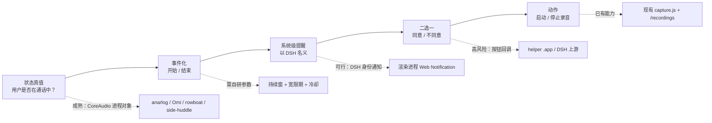
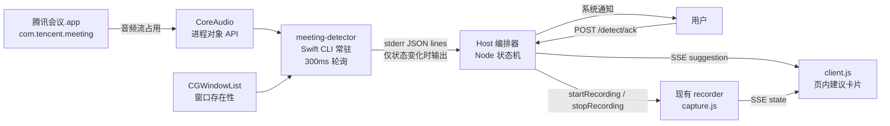
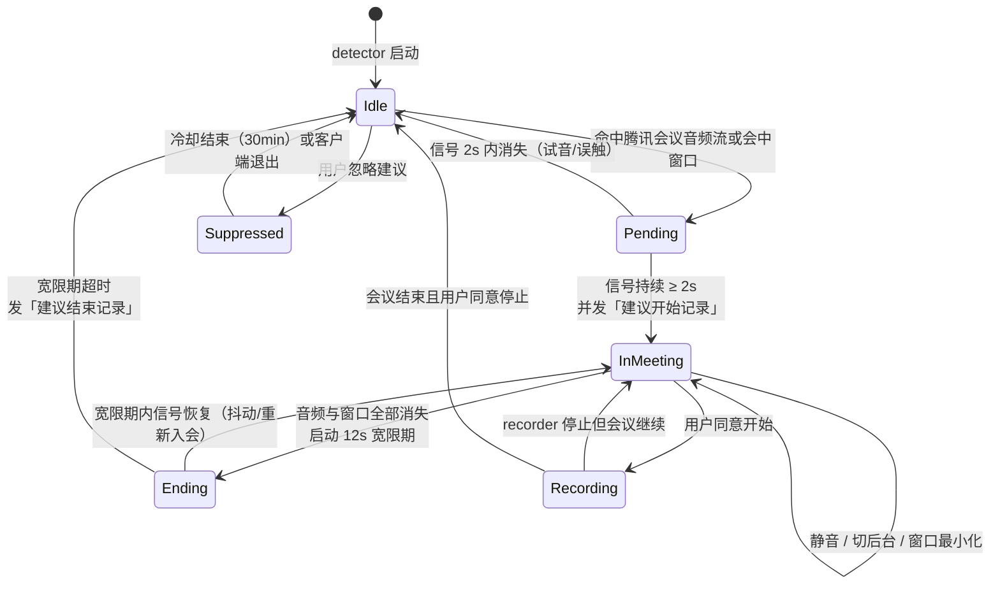
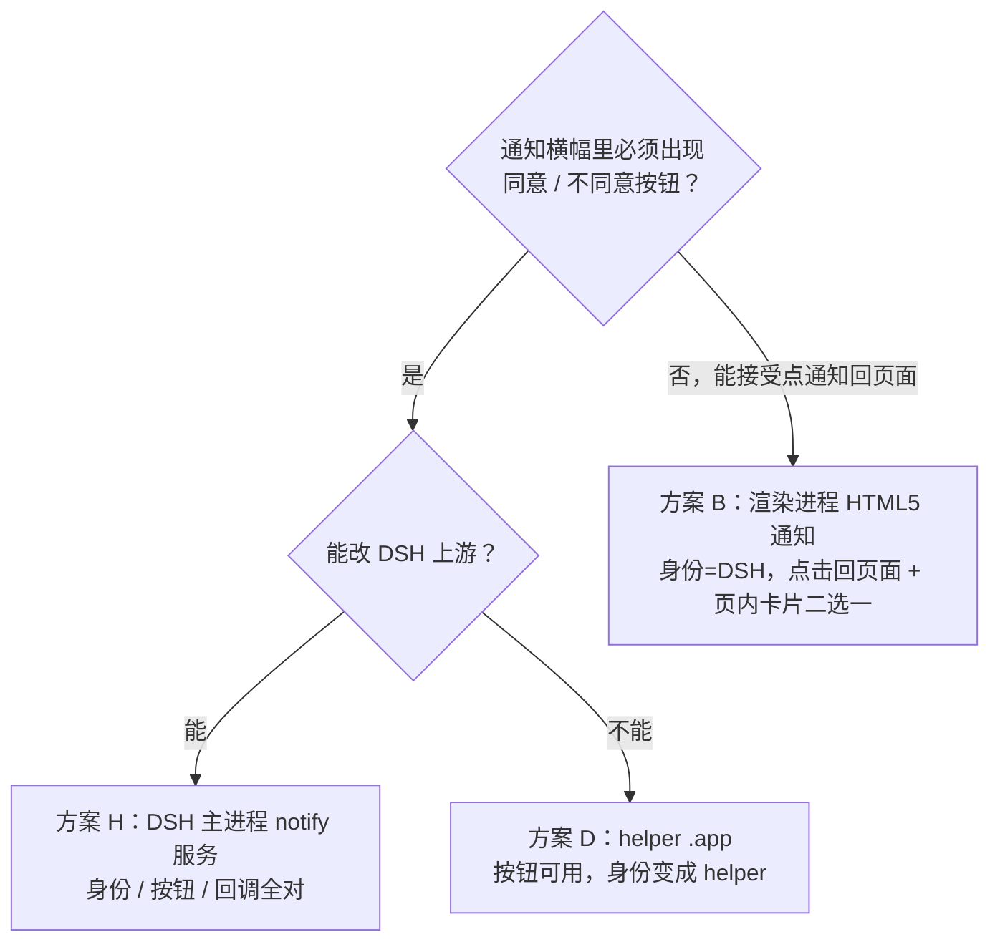
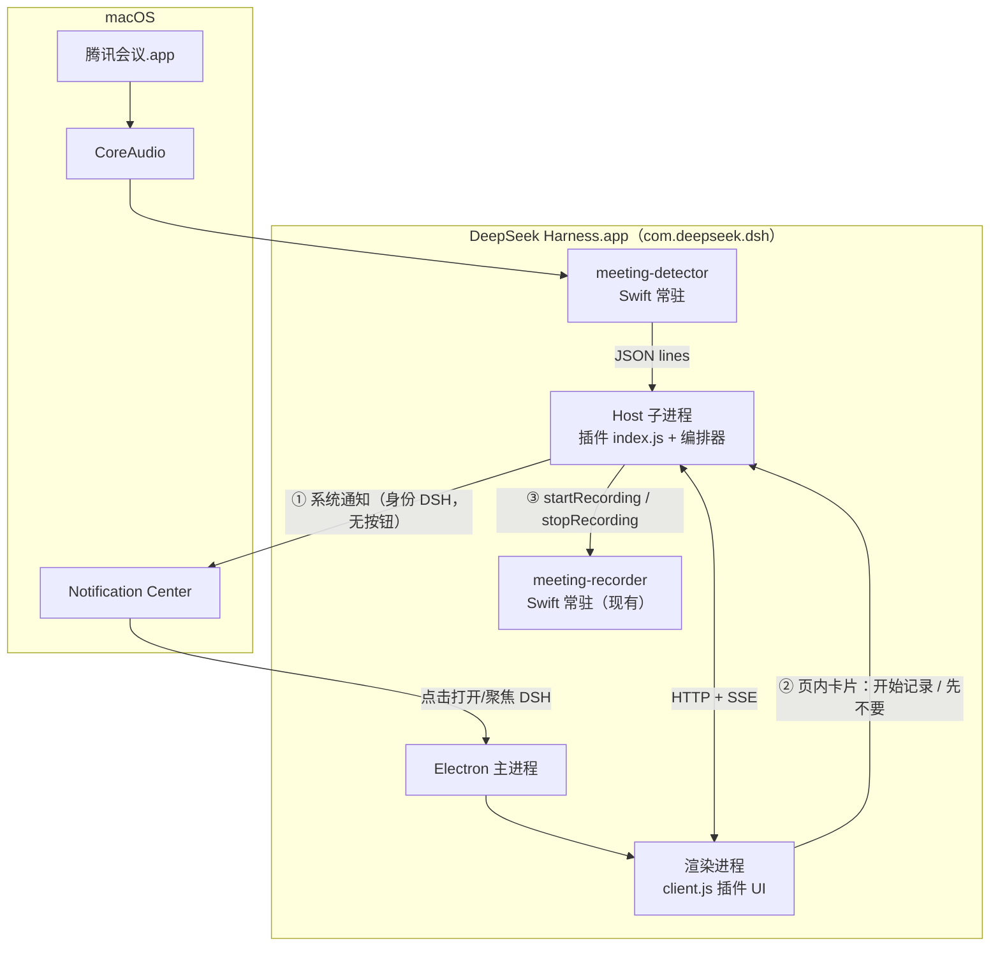
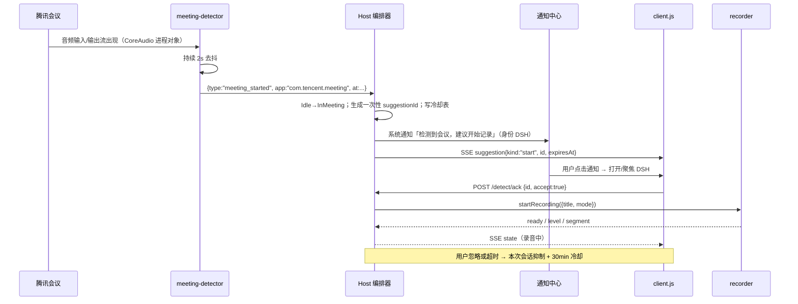

# 腾讯会议「开始/结束」检测 + 系统级确认通知 · 可行性调研

> 调研时间：2026-11-11 ｜ 本机：macOS 26.6.2（Apple Silicon）｜ 腾讯会议 3.47.2 ｜ DSH Desktop 0.2.2-rc.1（Electron 44.7.0）
> 目标插件：`@iceleaf/dsh-meeting-notes` v0.2.1（DeepSeek Harness 会议记录插件）
> 本文是调研与方案设计，**未修改仓库代码**（成文时）。
> 落地状态（2026-11-11 晚，v0.3.0）：已按方案 ①「身份优先」实现——DSH 身份的系统通知 + 插件页内卡片二选一；检测用 CoreAudio 进程对象，零 TCC 权限；桌面端可通过重启 DSH / 刷新页面加载。检测订阅常驻在插件启动作用域，DSH 运行期间（页面可最小化、可在其他对话）即可提醒；设置页提供「发送测试通知」用于自检 Desktop 渲染进程通知是否可见。下文保留调研与决策依据，实现细节以仓库代码与 README 为准。

**配套子报告（证据全文）：**

- 检测信号取证与本机实测：[`docs/research/detection.md`](./research/detection.md)
- GitHub / 商业产品先例：[`docs/research/prior-art.md`](./research/prior-art.md)
- 通知实现与 POC：[`docs/research/notification.md`](./research/notification.md)

---

## 0. 结论速览

**一句话：检测「腾讯会议是否在会中」可行且便宜；以 DSH 名义弹系统通知也有身份基础；但「DSH 身份 + 通知内两个按钮 + 可靠回调」这三个条件在当前 DSH 架构下无法同时满足——这是整条链路唯一需要你拍板的地方。**

| 子问题 | 结论 | 置信度 | 依据 |
|---|---|---|---|
| 检测腾讯会议「进入会议」 | **可行**。用 macOS 14.2+ CoreAudio 进程对象 API 看腾讯会议是否占用音频输入/输出，零 TCC 权限、抗沙盒、抗 UI 改版 | 高 | 本机实测 API 可用；anarlog / Omi / rowboat / side-huddle 同一机制 |
| 检测「会议结束」 | **可行但必须保守**：音频流消失 + 会中窗口消失，持续 10–15s 才判结束 | 中高 | obsidian-meeting-detector 连续 3 次缺失、Meetily 确认才停、Granola 多条件 |
| 检测信号是否依赖腾讯会议版本 | **低耦合**。只依赖 bundle id `com.tencent.meeting*` 与 CoreAudio 公共 API | 中高 | 腾讯会议升级只影响窗口文案/日志，不影响音频占用事实 |
| 以 DSH 身份发系统通知 | **身份基础成立、通路未打通**：Host 是 DSH.app 内子进程（`com.deepseek.dsh`），但 koffi 调 UN 的授权/回调未验证成功；渲染进程 HTML5 通知理论身份=DSH（机制成立，未在 DSH 内实测） | 中 | 本机 POC，见 §4.4 |
| 通知里两个按钮 + 回调 Host | **当前不可行/高风险**。macOS 原生通知只会把第一个 action 显示为按钮，其余要 hover；且按钮回调需要常驻 delegate + 主运行循环，Host 的 Node 事件循环需自行泵 CFRunLoop，点击还可能被路由给主实例 | 高（限制）/ 低（可行性） | Electron 官方文档 + 本机实测，见 §4.2/§4.3 |
| 纯插件、不改 DSH 能交付什么 | **「DSH 身份系统通知（无按钮、点击回页面）+ 页内卡片二选一」**，可靠、零签名成本 | 高 | 渲染进程 Web Notification + 现有 SSE/路由 |
| 工作量 | POC 0.5–1 人日；MVP 2–3 人日；完整（helper 按钮版）5–8 人日 | — | §8 |

**需要你拍板的三选一：**

| 选项 | 系统通知里能看到什么 | 同意/不同意在哪点 | 代价 |
|---|---|---|---|
| **① 身份优先（推荐 MVP）** | 身份 = DeepSeek Harness，文案「建议开始/结束记录」，点击回到插件页 | 页内卡片上点 | 通知里没有按钮；多一次点击 |
| **② 按钮优先** | 外部 helper .app 弹通知，横幅可带「同意/不同意」（第二个仍需 hover 展开） | 通知横幅/展开菜单 | 身份变成 helper 名字；需 Developer ID 签名 + 公证 + 多一个 App 条目 |
| **③ 上游正解** | 身份 = DSH，按钮与回调都由 DSH 主进程承担 | 通知横幅 | 需改 DSH 上游：暴露 `notify` 插件服务，并补 `Info.plist` 的 `NSUserNotificationAlertStyle=alert` |

> 我的建议：**先按 ① 落地 MVP（2–3 天）**，同时把 ③ 作为上游需求提给 DSH；② 只在"通知里必须出现按钮"是硬需求时才做，因为它的身份代价与用户"以 DSH 名义"的诉求直接冲突。

---

## 1. 需求本质：不是"检测腾讯会议"，是"用户此刻是否在通话中"

原始需求（m00001）：会议开始 → 系统级通知建议发起会议记录，可选同意/不同意；会议结束 → 系统级通知建议结束记录，可选同意/不同意。

拆成三个独立问题后，成熟度差异很大：

三条设计原则（先例一致，直接照抄）：

1. **建议式，不自动**：Granola 必须用户点、Meetily Pro 默认关闭、Otter 可配置。误触发一次，用户会永久关闭该功能。
2. **结束判定比开始更保守**：宁可晚 10 秒，也不要会议中途弹「建议结束」。
3. **不同意有后果**：本次忽略 + 冷却（默认 30 分钟）；用户手动开始/停止后抑制自动建议。

**不要为腾讯会议写死。** 腾讯会议官方没有本地事件：无 AppleScript 字典、URL scheme 只出不进、开放平台只覆盖服务端 Rooms/CSAPI 且需企业 OAuth。真实需求是"是否在通话中"，做成「会议 App 白名单 + 音频流判定」的通用 detector，腾讯会议只是一行 bundle id，顺带覆盖飞书/Zoom/Teams，也避免跟着客户端升级反复适配。

---

## 2. GitHub 先例调研结论

**没有项目实现过这条完整链路**，但每一环都有成熟先例（详见 [`prior-art.md`](./research/prior-art.md)）。

| 环节 | 有没有人做过 | 最接近的先例 | 可借鉴点 |
|---|---|---|---|
| 检测「某种会议软件在会中」 | 有，多套 | anarlog 9.8k★（`DetectEvent::MicStarted/MicStopped`）、Omi `ConferencingApps.swift`、rowboat `mic-monitor.swift`、side-huddle | CoreAudio 进程对象 + bundle 归因，是工业级通行做法 |
| 检测「**腾讯会议**在会中」 | **没有公开实现** | LobsterAI 只把 `com.tencent.meeting` 分类成 Meeting，无状态检测 | 需自己真机标定参数 |
| 检测「会议结束」 | 有，都靠组合条件 | Granola 三条件、Meetily「确认才停」+ 可取消倒计时、obsidian-meeting-detector 连续 3 次缺失（≈15s） | 宽限期 + 保守判定 |
| 系统通知 + 同意/不同意 + 回调 | 有 | side-huddle 的 UNNotificationCategory 双 action、terminal-notifier/alerter | 有坑：按钮折叠、身份归属、签名 |
| 同意后触发本地录音 | 有 | side-huddle、anarlog | 我们的 recorder 已具备 |

**产品侧的做法提醒我们两件事：**

- 几乎没人把"同意/不同意"塞进 macOS 原生通知横幅：Granola 用自家弹窗、screenpipe 用 460×124 卡片、anarlog 用自绘 NSPanel。**系统通知负责叫醒，完整交互放应用内**才是主流。
- 国内产品（飞书妙记、腾讯会议自带录制）都是生态内闭环；"跨应用自动检测 + 建议"不是标配，用户预期需要引导。

因此产品形态建议：**系统通知叫醒 + 插件页内卡片完成二选一**；如果一定要在通知里放按钮，再走 §4 的 helper / 上游路线。

---

## 3. 检测方案：CoreAudio 进程对象是地基

### 3.1 信号对比

| 信号 | 权限 | 时延 | 准确性 | 结论 |
|---|---|---|---|---|
| 进程存在（NSWorkspace/pgrep） | 无 | 秒级 | 低：启动客户端 ≠ 入会 | 只用于"客户端已启动" |
| 窗口存在性（CGWindowList） | 无 | 0.5–1s | 中：分不清主面板/会中 | 辅助；结束时可立即感知 |
| 窗口标题（`kCGWindowName`） | 屏幕录制 | 0.5–1s | 中高 | 可选，用于「《XXX 会议》」文案 |
| **CoreAudio 进程对象 input** | **无** | 300ms 轮询 + 2s 持续窗 | **高** | **主信号**：腾讯会议是否在采麦克风 |
| **CoreAudio 进程对象 output** | **无** | 同上 | **高** | 主信号（或关系）：是否在放会议音频 |
| 设备级 `IsRunningSomewhere` | 无 | 毫秒级 | 中低：无法归因到 App | 仅作快速唤醒/诊断 |
| Accessibility（AXUIElement） | 辅助功能 | 0.5s | 中：依赖 Qt 控件层级，升级易碎 | 不采用 |
| 容器内 `xcast_*.log` 明文心跳 | 无 | 2s | 中高：版本脆弱 | 仅诊断/校准 |
| 系统日志 / lsof / 通知中心 DB | 各异 | — | 低/不可用 | 不采用 |
| 官方 webhook / SDK / URL scheme | 企业凭证 | — | 仅服务端场景 | 不适用 |

> 关键洞察：进程/窗口只能回答"在不在"，CoreAudio 进程对象才能回答"是否真的在会中"，且零权限、对沙盒/加固进程同样有效。这是整个方案成本最低、最抗升级的地基。

### 3.2 推荐架构：独立常驻 detector + Node 状态机

为什么独立进程：

- recorder 只在录音时存在，检测需要常驻，两者生命周期必须解耦。
- detector 崩溃不影响录音；Swift 编译按现有 `recorder/build.sh` + `swiftc` 模式管理。
- 与先例一致（rowboat `mic-monitor.swift`、side-huddle 都是独立 watcher）。

### 3.3 状态机与参数

| 参数 | 建议值 | 依据 |
|---|---|---|
| 轮询间隔 | 300ms | side-huddle 同款；CoreAudio 读取开销可忽略 |
| 开始持续窗 | 2s | side-huddle `2-second sustain window`；避开试音/误触麦克风 |
| 结束宽限期 | 10–15s（默认 12s） | 覆盖静音发言、切网络、共享屏幕中断；宁晚勿误 |
| 同一建议冷却 | 30min | 防止反复骚扰 |
| 每会话上限 | 1 次 start + 1 次 stop 建议 | 状态机天然保证 |

**必须真机标定的未知数（不阻塞方向，阻塞参数定稿）：**

| # | 未知数 | 影响 |
|---|---|---|
| V1 | 会中窗口标题是否含"会中/会议"字样 | 窗口辅助信号是否可用、通知能否带会议名 |
| V2 | 会中静音时 `IsRunningInput` 是否保持 1 | 静音会不会被误判为结束 |
| V3 | 只听不说时 `IsRunningOutput` 是否保持 1 | 只听场景的判定 |
| V4 | 入会预览/等候室是否已开麦 | 是否"还没入会就弹建议" |
| V5 | 会议结束瞬间：音频流 vs 窗口谁先消失 | 结束判定时延与优先级 |
| V6 | 客户端退出后 helper 进程残留时长 | 是否误判"仍在会中" |
| V7 | 无屏幕录制权限时窗口标题为空 | 降级文案 |
| V8 | 共享屏幕/系统音频是否改变 input/output | 共享场景是否误判 |
| V9 | 与 recorder 共存是否自激 | 必须排除自身 pid |
| V10 | 客户端升级后上述信号是否变化 | 长期维护成本 |

### 3.4 权限与降级

| 能力 | 权限 | 缺权限时 |
|---|---|---|
| 音频流判定 | **无**（只读设备占用状态，不读音频内容） | — |
| 窗口存在性 | 无 | — |
| 窗口标题（可选） | 屏幕录制 | 文案退化为"检测到会议"，不显示会议名 |
| 系统通知 | 通知授权（首次弹窗） | 页内卡片仍可用；都被拒时只记录日志 |
| Accessibility | 不使用 | — |

> 本机实测宿主已有屏幕录制权限，且 recorder 子进程通常继承宿主 TCC 责任链；换机器需重新确认。检测主链路零权限，是相对 Omi（录屏）/anarlog（麦克风）的显著优势。

### 3.5 版本升级脆弱性

- **稳定**：bundle id `com.tencent.meeting*`、CoreAudio 公共 API、窗口存在性。
- **脆弱**：窗口标题文案、容器日志格式、helper 进程名单（`WemeetLauncher`/`Transcode` 等）；这些只做辅助/诊断，主判定永远走"音频流 + bundle 白名单"。
- helper 进程不参与判定，只用于排除误报；腾讯会议升级后回归 V10 即可。

---

## 4. 通知方案：身份、按钮、回调三者不可兼得

### 4.1 三个硬约束

1. **身份**：用户明确"建议以 DSH 这个应用的名义发通知"（m00130）——不能出现无名 helper、终端图标或浏览器图标。
2. **交互**：通知内容建议开始/结束记录，用户可同意或不同意。
3. **回调**：用户选择要触发 Host 的录音开始/停止，防重放、超时默认不记录。

再加一条现实约束：macOS 原生通知横幅**不会并排显示两个按钮**——只有第一个 action 直接显示，其余折叠进 hover 后的「选项/更多」（Electron 与 terminal-notifier 文档一致）。

### 4.2 DSH 架构事实（决定哪些路走不通）

| 事实 | 证据 | 影响 |
|---|---|---|
| 插件 Host 跑在 `ELECTRON_RUN_AS_NODE=1` 的 DSH 子进程里 | DSH 桌面主进程 spawn Host（`lib/main.js:9979`）；实测 `process.execPath` = DSH 可执行文件，`process.versions.electron` = 44.7.0 | **拿不到 Electron 主进程 `Notification`**：`require("electron")` → MODULE_NOT_FOUND |
| Host 子进程 `mainBundle` 是 DSH | koffi：`[NSBundle mainBundle] bundleIdentifier` = `com.deepseek.dsh`，bundlePath = `/Applications/DeepSeek Harness.app` | 原生 API 发通知时**身份可以是 DSH**（原理可行） |
| `UNUserNotificationCenter` 在 Host 内可获取 | `currentNotificationCenter` 返回对象，进程未崩 | 框架可用；但授权/按钮回调未打通 |
| DSH 主进程 Notification 只服务强制更新 | `main.js:17672` 附近 `new Notification({...mandatoryNotification...})` | 没有插件 API；preload 桥无通知通道 |
| Host→主进程 IPC 封闭 | 未知消息 → 主进程判 `invalid IPC event` 并 SIGTERM Host | 不能"借"主进程发通知 |
| DSH 尚未请求过通知授权 | `~/Library/Preferences/com.apple.ncprefs.plist` 无 `com.deepseek.dsh` 条目 → notDetermined | 首次弹授权弹窗不可避免 |
| DSH 的 Info.plist 缺按钮生效键 | 无 `NSUserNotificationAlertStyle`（`codesign` 显示 `com.deepseek.dsh`、Developer ID 签名、hardened runtime） | 即使上游做按钮版也要先补此键 |
| legacy `NSUserNotification` 在 macOS 26 已废 | 实测 `setOtherButtonTitles:` → unrecognized selector；`deliverNotification` 无可见横幅 | "用老 API 伪造 DSH 身份"这条路死了 |

**结论**：`prior-art.md` 里"插件在 index.js 里 `import { Notification } from 'electron'`"的路线在现有 DSH 架构下**不成立**，需修正为「Host 内原生 UN」或「渲染进程 Web Notification」。

### 4.3 候选方案对比

| # | 方案 | 通知身份 | 双动作按钮 | 点击回调 | 成本/风险 | 评价 |
|---|---|---|---|---|---|---|
| A | Host + koffi 调 `UNUserNotificationCenter`（带 action） | **DSH**（理论上） | 可（第二个需 hover） | 需主运行循环持有 delegate；Host 的 Node 事件循环不跑 CFRunLoop | 高：授权/回调未打通；同 bundle 多实例点击可能投给主进程 | 待验证，不押注 |
| B | 渲染进程 HTML5 `new Notification()` | **DSH**（Electron 以 app 身份提交） | ❌ 无 actions | ✅ `onclick` 回页面 | 低：零签名、共用 DSH 授权 | **MVP 推荐** |
| C | 浏览器 Web Notification（Web profile） | 浏览器 | ⚠️ 有 actions，但 macOS 要 hover「更多」 | ✅ `notificationclick` / SW | 低 | Web 降级 |
| D | helper .app + UNCategory 双 action | helper 自己（如 DSH Meeting Notes） | ✅ 可（第二个仍折叠） | ✅ helper 收 delegate → HTTP POST Host | 中高：必须 Developer ID 签名 + 公证；ad-hoc 实测 `UNErrorDomain error 1`；多一个 App 条目 | 按钮是硬需求时才做 |
| E | terminal-notifier 3.1.0 | 固定 `terminal-notifier`（v3 **已移除** `-sender`，无法伪装 DSH） | ⚠️ 多动作折叠 | ✅ stdout 返回选中项 | 低；本机 exit 3（授权被拒） | 不满足身份，不推荐 |
| F | osascript `display notification` | Script Editor | ❌ | ❌ | 极低 | 不满足身份 |
| F2 | osascript `display dialog` | — | ✅ 真按钮 | ✅ 返回值 | 阻塞、抢焦点、模态，不是通知 | 不推荐 |
| G | 只做页内卡片 | — | 页内 | 直接 | 低 | 全屏会议时看不见，不满足"系统级" |
| H | **DSH 上游暴露 `notify` 插件服务** | **DSH** | ✅（补 `NSUserNotificationAlertStyle`） | ✅ 主进程 action → 桥 → Host | 需改 DSH 上游 | **中期正解** |

### 4.4 本机 POC 结果

**已确认：**

- `ELECTRON_RUN_AS_NODE=1` 启动 DSH 可执行文件：`mainBundle.bundleIdentifier = com.deepseek.dsh`；`[UNUserNotificationCenter currentNotificationCenter]` 可获取；`CFRunLoopRunInMode(0.2)` 可正常返回（runloop 可在 node 主线程驱动）。
- 插件 Host 无法 `require('electron')`；DSH preload 的 `DESKTOP_IPC` 通道无通知相关通道。
- 渲染进程 HTML5 通知机制：Electron 由主进程以 app 身份提交，身份=DSH，`onclick` 回页面；Electron 的 HTML5 实现不支持 `actions`。
- terminal-notifier v3 官方移除 `-sender`；本机未安装 alerter（唯一带 `--sender` 的现成工具，未验证）。

**未打通/未验证：**

1. koffi 构造 Objective-C block 有缺陷（已用 `NSArray enumerateObjectsUsingBlock:` 自检确认 block 未执行），因此 `requestAuthorization` 回调**尚不能判定** UN 方案不可行；修 block 后需重测（预计 0.5–1 天）。
2. 同 bundle id 多实例（DSH 主进程 + helper）时，系统把通知点击路由给谁——只有真实签名环境可验证。
3. 渲染进程 HTML5 通知在 DSH 内的实际显示名与点击行为（机制推断成立，未在 DSH 内实测）。
4. helper .app 在 Developer ID 签名 + 公证后的真实表现（ad-hoc 已被系统拒绝）。

> 完整命令、截图与实验产物见 [`notification.md`](./research/notification.md)（本机实验目录 `/tmp/nt-research/`）。

### 4.5 决策与推荐

**推荐：先做 B，把 H 作为上游需求；D 只在按钮是硬需求时启用。**

理由：

- B 是唯一**纯插件、身份正确、零签名成本**的方案；缺点是通知里没有按钮，用户点通知回到插件页，再在卡片上点「开始记录 / 先不要」。这比"通知里两个按钮"多一次点击，但先例（Granola/screenpipe/anarlog）都证明这是主流形态。
- D 能满足"横幅里有按钮"，但身份变成 helper，与用户"以 DSH 名义"的诉求正面冲突，且发布链路要加 Developer ID 签名 + 公证（成本与维护面显著上升）。
- H 是长期正解：DSH 主进程暴露 `notify({title, body, actions, onAction})`，插件注册回调，身份/按钮/回调一次解决；上游还需补 `NSUserNotificationAlertStyle=alert`。

---

## 5. 推荐落地设计（MVP = 方案 B）

### 5.1 组件与数据流

### 5.2 关键时序（开始）

结束流程对称：`meeting_ended` → 宽限期确认 → 通知「会议可能已结束，建议结束记录」→ 同意则 `stopRecording()`。

### 5.3 新增接口与配置（建议，本次不实现）

| 接口 | 作用 |
|---|---|
| `GET /dsh-meeting-notes/detect` | 当前检测状态、最近事件、待处理 suggestion |
| `POST /dsh-meeting-notes/detect/ack` | `{suggestionId, accept}`；校验有效期与一次性，防重放 |
| SSE 新增事件 `suggestion` | 推送/撤销建议，驱动页内卡片 |

配置项（`DEFAULT_CONFIG` 增量，全部有默认值）：

| key | 默认 | 说明 |
|---|---|---|
| `detectEnabled` | `true` | 总开关；检测本身不读音频内容、不自动录音，首次发通知时会弹一次系统授权 |
| `detectNotify` | `true` | 是否发系统通知（关闭则只显示页内卡片） |
| `detectStartSustainSeconds` | `2` | 开始持续窗 |
| `detectEndGraceSeconds` | `12` | 结束宽限期 |
| `detectCooldownMinutes` | `30` | 忽略后的冷却 |
| `detectShowWindowTitle` | `false` | 是否在通知里带会议标题（需屏幕录制权限） |
| `detectApps` | `["com.tencent.meeting"]` | 会议 App 白名单（预留扩展） |

### 5.4 回调安全

- 一次性 `suggestionId`（HMAC 或随机 + 服务端表），带过期时间（建议 5–10 分钟），**单次使用**。
- 沿用现有 `POST` + `x-dsh-meeting-notes` 头与 `127.0.0.1` 绑定；不新增长期密钥。
- **默认不记录**：未收到「同意」前绝不 `startRecording`；超时/关闭/忽略一律视为拒绝。
- 同一 `meetingId + kind` 只允许一个 pending suggestion；重复事件用 id 去重。
- 若未来启用 helper（方案 D），helper 与 Host 之间用一次性 token，不暴露可重放的接口。

---

## 6. 交互与文案

- **系统通知（zh）**
  - 开始：「检测到腾讯会议可能已开始。要开始记录这场会议吗？」
  - 结束：「检测到会议可能已结束。要结束会议记录吗？」
  - 点击 → 打开 DSH 并高亮插件页卡片；无按钮版文案需引导点击：「点击选择」。
  - 若采用 helper 按钮版：「开始记录 / 先不要」「结束记录 / 继续记录」。
- **页内卡片**（`mn-` 前缀，遵循 DSH 设计系统）：
  - 标题 + 一句说明 + 主按钮（开始记录/结束记录）+ 次按钮（先不要/继续记录）+ 关闭；
  - 显示检测依据（腾讯会议 · 会中/已结束）与可选倒计时；
  - 属于"建议"而非不可撤销操作，用卡片而非 ConfirmDialog；操作结果用 Toast。
- **忽略语义**：本次会话不再建议；30 分钟后若仍检测到会议可再次提醒（可配置）。
- **手动操作抑制**：用户手动开始/停止后，本轮会话不再自动建议。
- **权限引导**：通知授权被拒 → 设置页 inline Banner 提示"系统通知已关闭，请在系统设置中允许 DSH 通知"，不反复弹系统授权。
- **隐私**：录制开始后页面/通知文案体现"正在记录"；不做静默录音。
- **文案一致性**：`DICT_ZH` / `DICT_EN` 同步；若通知由 Host 发出，也需要 zh/en 两份（跟随 `ctx.locale` 或配置 language）。

---

## 7. 风险清单与对策

| 风险 | 严重度 | 说明 | 对策 |
|---|---|---|---|
| 自激：recorder 占麦被当成会议开始 | 高 | 插件自己的录音会触发 detector | detector 排除自身 pid；只匹配会议 App bundle；Recording 状态下不发 start 建议 |
| 静音/只听误判结束 | 高 | 会中静音时 input 可能归零 | input/output 或关系 + 窗口存在性 + 12s 宽限；真机标定 V2/V3 |
| 入会预览提前触发 | 中 | 等候室/试音可能已开麦 | 2s 持续窗 + 窗口辅助；V4 验证后调参 |
| 误触发一次导致用户永久关闭 | 高 | 产品生死线 | 永不自动录音；建议式文案；冷却；总开关一键关 |
| 通知身份不是 DSH | 中 | helper/terminal-notifier 身份错位 | 优先 B/H；不引入第三方通知器 |
| 通知按钮折叠/不可见 | 中 | macOS 只会把第一个 action 显示为按钮 | 若做按钮版，接受折叠或引导 Alert 样式；文案不依赖按钮可见 |
| 通知权限被拒 / 专注模式 | 中 | 通知可能完全不显示，且系统不报错 | 页内卡片兜底；设置页提示；超时=拒绝；不阻塞录音 |
| 同 bundle 多实例点击错投 | 中 | DSH 主进程 + helper 抢路由 | 不引入同 bundle helper；helper 用独立 bundle id |
| helper 签名/公证成本 | 中 | macOS 26 对 ad-hoc 直接拒绝通知 | 只有按钮硬需求才做；CI 加 notarytool |
| Web profile 身份是浏览器 | 低 | Web 下无法以 DSH 名义 | 明确降级；文档写清两种 profile 差异 |
| 腾讯会议升级导致信号变化 | 中 | 窗口/helper/日志会变 | 主判定只用音频 + bundle；诊断信号可关 |
| 性能开销 | 低 | 300ms 轮询 + 窗口枚举 | 实测 CPU；窗口枚举可降到 1s；detector 空闲休眠 |
| 隐私/合规 | 高 | 录音需告知参会者 | 沿用现有录音提示；通知与页面明确"正在记录"；本地存储 |

---

## 8. 分期落地计划

| 阶段 | 内容 | 工作量 | 验收标准 |
|---|---|---|---|
| P0 真机标定 | 用 `detection.md` 的探针在真实会议采样 V1–V10；确认静音/只听/结束时序 | 0.5–1 天 | 参数表定稿；确认无误判路径 |
| P0 通知 POC | 验证渲染进程 HTML5 通知身份/点击；修 koffi block 后重测 UN 授权回调（可选）；helper 签名版可行性（可选） | 0.5–1 天 | 明确 B 可用；A/H 的结论固化 |
| P1 MVP | detector + 状态机 + 页内卡片 + DSH 身份系统通知（无按钮）+ 配置/冷却/抑制 + SSE | 2–3 天 | 真实会议开始/结束各弹一次；忽略后冷却；手动录音不自激 |
| P2 增强 | 按钮版通知（helper 或上游服务）、窗口标题、诊断模式 | 2–4 天 | 按钮点击直达录音；标题正确；版本升级回归 |
| P3 打磨 | 文案 zh/en、设置项、权限引导、性能、文档 | 1–2 天 | smoke/preview 通过；README/CHANGELOG 更新 |

**MVP 明确不做**：Accessibility、通知中心 DB、lsof、官方 webhook/SDK、URL scheme 回调、自动开始录音（默认只提醒）。

---

## 9. 待验证清单

**检测侧（真机）**：V1–V10（§3.3）。

**通知侧（本机/签名环境）**：

1. 修 Objective-C block 构造后，Host 内 `requestAuthorization` 是否收到回调。
2. Host 发 UN 通知是否显示、身份是否 DSH。
3. 带 2 个 action 的通知形态与点击回调。
4. 同 bundle id 多实例时点击路由到哪个进程。
5. 渲染进程 HTML5 Notification 在 DSH 内的实际显示名、点击事件、权限来源。
6. helper .app 在 Developer ID 签名 + 公证后的通知注册与按钮回调。

---

## 10. 参考资料

**本仓库调研**

- [检测信号取证与本机实测](./research/detection.md)
- [GitHub / 商业产品先例](./research/prior-art.md)
- [通知实现与 POC](./research/notification.md)

**检测先例**

- fastrepl/anarlog（Hyprnote）：CoreAudio 进程对象 `DetectEvent::MicStarted/MicStopped` — <https://github.com/fastrepl/anarlog>
- rowboat `mic-monitor.swift` — <https://github.com/rowboatlabs/rowboat>
- Omi `ConferencingApps.swift` — <https://github.com/BasedHardware/omi>
- kenotron-ms/side-huddle：Teams/Zoom/Meet 检测 + 通知双按钮 — <https://github.com/kenotron-ms/side-huddle>

**产品做法**

- Granola 通知与转写帮助 — <https://docs.granola.ai/help-center/taking-notes/notifications>
- Meetily Pro 自动记录与倒计时 — <https://meetily.ai/releases/pro/1.9.2>
- screenpipe 会议卡片 — <https://github.com/mediar-ai/screenpipe>

**系统 API**

- CoreAudio 进程对象：`kAudioHardwarePropertyProcessObjectList` / `kAudioProcessPropertyIsRunningInput`（macOS 14.2+）
- UserNotifications：`UNUserNotificationCenter` / `UNNotificationAction` / `UNNotificationCategory`
- CGWindowList：`CGWindowListCopyWindowInfo`（窗口存在性无需屏幕录制）

**通知实现与坑位**

- Electron Notification 文档 — <https://www.electronjs.org/docs/latest/api/notification>
- Electron NotificationAction — <https://www.electronjs.org/docs/latest/api/structures/notification-action>
- Chrome macOS 原生通知（action 需 hover「更多」）— <https://developer.chrome.com/blog/native-mac-os-notifications>
- terminal-notifier（v3 移除 `-sender`、多 action 折叠）— <https://github.com/julienXX/terminal-notifier>
- alerter（`--sender` 可改发送者，未验证）— <https://github.com/vjeantet/alerter>
