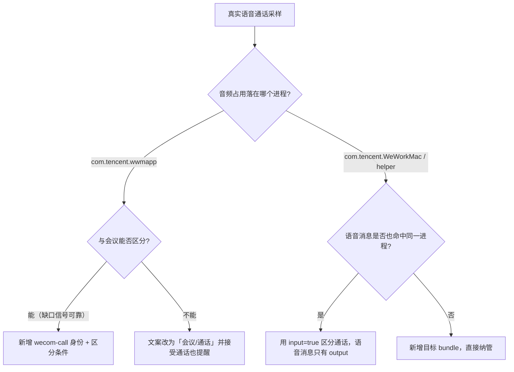

# 需求池

记录已确认方向、但受客观条件限制暂时不能实现/验证的需求。每条需求写明：目标、已知事实、待验证问题、验证步骤、实现分支、验收标准。

## R1 企业微信语音通话纳入「建议记录」

- **状态**：待验证（2026-11-11 记录）
- **来源**：用户明确要求「把语音通话也纳入建议记录」，但当前无法自测——语音通话需要与另一个人真实通话。
- **与 v0.4.0 的关系**：v0.4.0 已经支持企业微信**内置会议**（`com.tencent.wwmapp`）的开始/结束提醒；本需求只增加**一对一/多人的语音通话**场景，不改会议逻辑。

### 目标

企业微信语音通话开始时，2 秒内弹出「建议开始记录」卡片与系统通知；通话结束时，按 12 秒宽限弹出「建议结束记录」。语音消息播放**不触发**任何建议。

### 已知事实（本机实测，2026-11-11）

| 事实 | 证据 |
| --- | --- |
| 企业微信内置会议跑在独立子进程 `wwmapp`（进程名「企业微信·会议」，bundle `com.tencent.wwmapp`） | 会中采样 `input:true, output:true`；退出会议后立刻变 `false` |
| 企业微信主进程 bundle 为 `com.tencent.WeWorkMac`，进程名「企业微信」 | 会中/空闲均 `input:false, output:false`（会议不用主进程音频） |
| 主程序内含 VoIP/通话实现：`VoipServiceImpl`、`Conversation.VoiceCall`、`VoiceCallArchive` | 主程序二进制字符串 |
| `wwmapp` 是腾讯会议 SDK 3.26.511 的会议壳，`LSUIElement=true`（后台常驻） | `wwmapp.app/Contents/Info.plist` |
| `wwmapp` 空闲时仍保留一个 `layer=0` 的窗口，`window` 恒为 true | 空闲采样与会中采样对比；**窗口不能用来区分会议/通话** |

### 核心未知（必须先实测）

1. 语音通话时，音频占用落在哪个进程？
   - `com.tencent.wwmapp`（与会议复用同一进程）？
   - `com.tencent.WeWorkMac`（主进程 VoIP）？
   - `88L2Q4487U.com.tencent.wework.helper`（CEF 渲染/媒体 helper）？
   - 还是多个进程同时占用（例如麦克风在主进程、扬声器在 helper）？
2. 语音消息播放时，音频占用落在哪个进程？是否与语音通话命中同一个进程？
3. 通话期间 `input` / `output` 是否都稳定为 true？如果只有 `output`（对方说话）或只有 `input`，去抖参数需要重新标定。
4. `wwmapp` 在同一账号下，会议与通话是否会互相切换窗口/进程，是否存在可用的辅助信号（窗口标题、进程启动参数）——目前看窗口信号不可用。

### 验证步骤（等一次真实语音通话，约 1 分钟）

通话前确认企业微信已启动，然后运行（只用现有二进制，不装新工具）：

```bash
cd /Users/iceleaf/Workspaces/dsh/dsh-meeting-notes
{ sleep 60; echo '{"cmd":"stop"}'; } | \
  recorder/.build/meeting-detector \
    --bundle com.tencent.WeWorkMac \
    --bundle com.tencent.wwmapp \
    --bundle 88L2Q4487U.com.tencent.wework.helper \
    --interval-ms 500 \
  2> /private/tmp/wecom-call.jsonl >/dev/null
```

- 通话开始后再说一句话、让对方也说一句，覆盖 `input`/`output` 两个方向；
- 结束后再**播放一条语音消息**，用同一命令再采 20 秒；
- 把 `/private/tmp/wecom-call.jsonl` 留作证据，回答上面 4 个未知。



### 实现分支（拿到数据后二选一）

- **分支 A：通话复用 `wwmapp`**
  - 若无法与会议区分：把检测语义扩成「会议/通话」，`appName` 对 `wwmapp` 统一为「企业微信会议/通话」，文案相应调整；这是成本最低、风险最低的做法。
  - 若能找到可靠区分信号（需实测，窗口目前看不行）：再引入 `wecom-call` 身份。
- **分支 B：通话走主进程 / helper**
  - 新增对应 bundle 目标，但必须加区分条件，否则语音消息、聊天里的视频播放都会误报；
  - 首选区分条件：**只有 `input=true` 才视为通话**（语音消息/视频播放只有输出，不占麦克风）；如果实测通话也只占 output，则此路不通，需要窗口或会议状态辅助信号。
  - 注意：主进程 `com.tencent.WeWorkMac` 的 `input=true` 也可能来自「按住说话」录音，需实测按住说话时是否持续 >2 秒；若是，需要提高 sustain 或结合窗口。

### 验收标准

1. 与真人语音通话开始后 ≤2 秒出现「建议开始记录」，结束 12 秒内出现「建议结束记录」，同意/忽略行为与会议一致；
2. 播放语音消息、按住说话、聊天视频播放均不触发建议；
3. 腾讯会议、企业微信内置会议的现有行为不回归（`test/detect.test.mjs` + 真机回归）；
4. 系统通知与卡片文案能区分「企业微信会议」与「企业微信通话」。

### 风险与边界

- **合规**：通话录音涉及对方知情与同意；产品文案应提示「录音前请确认已获得对方同意」，默认不自动录音的现有约束不变。
- **误判代价**：误弹一次建议只是打扰，不会自动录音；但频繁误报会让人关掉总开关，所以宁可漏报不可误报。
- **版本差异**：企业微信 5.0.13 / wwmapp 3.26.511；升级后进程模型可能变化，实现时不要把 bundle 写死到只有会议识别的假设里。
- **暂不做**：不读取音频内容；不做通话内容识别；不做自动录音。
