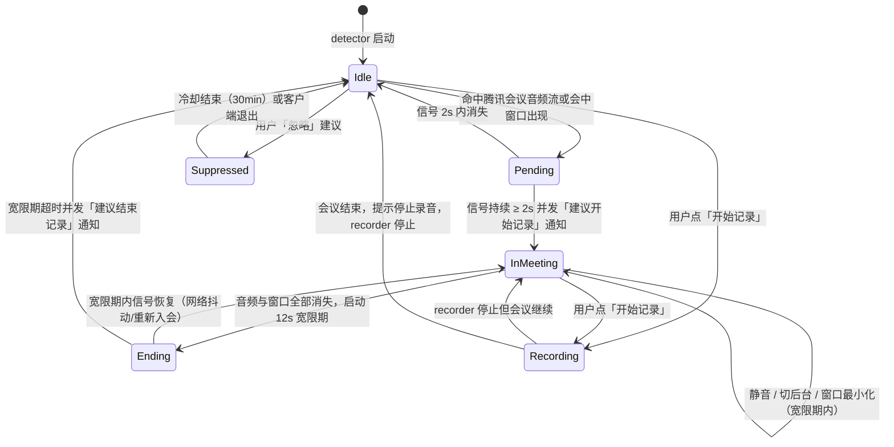

# 腾讯会议「开始 / 结束」检测技术调研

> 目标：检测用户**进入腾讯会议** → 弹系统通知建议开始记录；**会议结束** → 弹通知建议结束记录。
> 范围：仅调研，不改仓库代码。调研时间 2026-11-11，本机 macOS 26.x，腾讯会议 3.47.2。
> 文中每条结论标注来源：`[实测]` 本机只读实验、`[文献]` 官方文档/开源实现、`[待测]` 必须真开会才能验证。

---

## 0. 结论速览（TL;DR）

**推荐组合（主 → 辅）：**

| 层 | 信号 | 作用 | 权限 |
|---|---|---|---|
| 主判定 | CoreAudio **进程对象**：`kAudioHardwarePropertyProcessObjectList` + `kAudioProcessPropertyIsRunningInput/Output`，匹配 `com.tencent.meeting*` | 判断"腾讯会议此刻是否在采麦克风/放音频" = 是否真的在会中 | **无** |
| 辅助确认 | `CGWindowListCopyWindowInfo`：窗口存在性（owner pid / layer / bounds）**无权限**；窗口标题需屏幕录制权限 | 区分「主面板」与「会中窗口」；结束时可做到**立即**判定（窗口消失先于音频流关闭） | 存在性无 / 标题需屏幕录制 |
| 结束判定 | 音频流消失 **且** 会中窗口消失，需持续一个宽限期（8–15s）才判定结束 | 抗静音、抗网络抖动、抗切后台 | — |
| 兜底/诊断 | 容器内 `xcast_YYYYMMDDHH.log` 明文媒体日志（每 2s 一条会话心跳） | 端到端验证用；**不建议**做线上主信号（版本脆弱） | 无 |

**一句话**：macOS 上没有"腾讯会议已入会"的官方本地事件，但 **macOS 14.2+ 的 CoreAudio 进程对象 API 把"谁在用麦克风/扬声器"变成了事实而非猜测**，这是唯一既无权限、又对沙盒/加固进程有效、且不依赖 UI 的检测基础。

**最大风险（按严重度）：**
1. **自激陷阱**：本插件的 recorder 自己也占用麦克风。若不按 pid/bundle 排除自身，会把"自己在录音"识别为"会议开始"，形成无限建议循环 `[文献]`（参见 §3.4）。
2. **静音期误判结束**：腾讯会议在会中**静音且无人说话**时是否仍保持音频输入流，`[待测]`。报告 Readme 的客户端通常保持输出流，但输入流可能被关闭 → 只靠 input 会误判"会议结束"。
3. **权限归因**：窗口标题依赖屏幕录制权限。好在 recorder 由 DSH 进程拉起的子进程，TCC 责任链通常继承宿主（本机宿主已授权，`CGPreflightScreenCaptureAccess() == true` `[实测]`），但换机器/换宿主需重新确认。
4. **入会预览窗口提前触发**：`InMeetingJoinWindowController*` 阶段可能已打开麦克风试音 `[待测]`，会造成"还没入会就弹建议"。
5. **版本升级脆弱性**：所有"窗口标题 / 日志格式 / 资源文案"类信号都随客户端升级而变；只有 bundle id（`com.tencent.meeting`）与 CoreAudio API 是稳定的。

---

## 1. 腾讯会议 macOS 客户端画像

### 1.1 基本信息 `[实测]`

| 项 | 值 | 取证方式 |
|---|---|---|
| 安装路径 | `/Applications/TencentMeeting.app` | `ls` |
| Bundle ID | **`com.tencent.meeting`** | `plutil -p Info.plist` |
| 可执行进程名 | **`TencentMeeting`**（`CFBundleExecutable`） | Info.plist |
| 版本 | `CFBundleShortVersionString = 3.47.2`，`CFBundleVersion = 136826384`，framework 目录 `3.47.2.407` | Info.plist / `ls Versions` |
| 显示名 | 腾讯会议 / TencentMeeting | Info.plist |
| URL schemes | **`wemeet3`、`wemeet`**（另有 `wwauth3rd*` 企业微信授权 scheme） | Info.plist `CFBundleURLTypes` |
| UI 框架 | Qt（`QtCore/QtGui/QtWidgets/QtStateMachine/QtSvg/QtXml` + `qt_ui_framework.framework`、`wemeet_qt.framework`） | `ls Frameworks` |
| 资源体系 | 腾讯自研 nxres（`Resources/nxres/resources.fb` flatbuffer + `res/drawable-xxhdpi-v4/*.svg|apng`） | `ls` / hexdump |
| 主二进制 | 仅 139KB（launcher），真实代码在 `Contents/Frameworks/WeMeetFramework.framework/Versions/Current/WeMeetFramework` | `ls -l` |
| 沙盒 | 是，容器 `~/Library/Containers/com.tencent.meeting/` | `ls` 可读 |
| 最低系统 | `LSMinimumSystemVersion = 10.12` | Info.plist |
| TCC 用途声明 | 麦克风、摄像头、`NSAudioCaptureUsageDescription`（系统录音/共享电脑声音）、日历、蓝牙、AppleEvents（PPT 翻页） | Info.plist |

**嵌套 helper（均 `LSUIElement=true`，不显示 Dock 图标）：**

| Bundle ID | 说明 |
|---|---|
| `com.tencent.meeting.WemeetLauncher` | 单实例守护/重启器（`AppLauncherHost`/`AppLauncherMutex`/`AppLauncherWatcher`），路径在 `WeMeet.framework/Versions/A/Resources/WemeetLauncher.app`；strings 含 `[app terminate] app launcher host, need start app by osascript` |
| `com.tencent.meeting.Transcode` | 转码 |
| `com.tencent.wemeet.FileDelta` | 增量更新 |
| `com.tencent.meeting.services.wmexternal` | 外部服务 |

**另一条要注意的进程线**：`/Applications/TeamSecurityManager.app`（`com.tencent.TeamSecurityManager` 2.0.0.4，含 `TMMonitor.app`/`TMUpdate.app`）本机常驻（PID 522 daemon + TMMonitor），但它**不是腾讯会议本体**（本机由企业微信侧安装），检测时**不要**把它当会议信号。

### 1.2 进程模型 → 能不能靠"进程在不在"判断

- 主 app 是普通 GUI app（无 `LSUIElement`），退出即消失 `[实测]`（本机当前未运行，`pgrep -fl wemeet` 无输出）。
- **"腾讯会议启动"≠"进入会议"**：用户可能只是打开主面板看日程/历史会议。因此**进程存在性只能当"客户端已启动"的粗信号，不能当"会中"**。
- 会中是否存在独立音频进程：`[待测]`（Qt 单进程 + 大量 dylib 的可能性最大，音频走 `WeMeetFramework`，bundle id 应为 `com.tencent.meeting`；但也不排除 `wmexternal`/`Transcode` 承担媒体，匹配规则要用前缀 + 可执行路径双条件，见 §3.2）。
- 客户端退出后 `WemeetLauncher` 可能短期常驻用于重启 `[文献/strings 推断]`，**不要**用 launcher 存在性做任何判断。

### 1.3 窗口与标题

- 官方 UI 文案里明确存在两套窗口语义 `[实测]`（`WeMeetResource.bundle/Contents/Resources/zh-Hans.lproj/Localizable.strings`）：
  - `"DockMenuMeetingWindow" => "{app_name}（会中）"`
  - `"DockMenuMainWindow" => "{app_name}"`
  - `"MeetingWindowControllerGoingIntoMeeting" => "正在进入会议..."`
  - `"ChangeHostWindowControllerEnd" => "结束会议"`
  - `"InMeetingJoinWindowController*"`（入会昵称/密码/加入会议）→ 说明**入会前有一个独立预览窗口**
  - in_meeting_module `resources.fb` 含 `"离开会议"`、`LeaveMeetingWindowTitle`
- 全 bundle（875MB）用 `grep -a "腾讯会议"` 扫描 UTF-8 **无命中**（除 `.strings` 文件）→ 窗口标题不是硬编码明文，**无法用 strings 取证标题规律**，必须真机看 `CGWindowList`。
- 内部路由字符串（`WeMeet.framework/Versions/A/WeMeet`）：`wemeet://page/home`、`wemeet://page/inmeeting`、`wemeet://page/inmeeting_revision`、`wemeet://page/inmeeting/screen_share_toolbar`、`wemeet://page/after_meeting_summary`、`wemeet://page/alert/leave_meeting_sleep` 等 → **这是客户端内部导航路由，不是对外事件接口**。

> `[待测]` 需要在真机确认：主面板窗口标题、会中主窗口标题（猜测是会议主题或"腾讯会议"）、语音激励/成员列表等悬浮窗（layer 可能 >0）、共享屏幕工具条窗口。

### 1.4 容器内可观测痕迹 `[实测]`

| 路径 | 内容 | 可用性 |
|---|---|---|
| `Data/Library/Global/Logs/xcast_YYYYMMDDHH.log` | **明文**媒体引擎日志，每 2s 一条会话心跳；含 `[AV_SESSION]`、`Channel[491105246, elapsed 328746]`、Snd/Rec 码率 | 可直接解析出"何时在会中"；但格式随版本变 |
| 同上 `wmp_*.log`、`lchr_meeting_*.log` | 自定义二进制（头 `03007a`/`03007b`），不可读 | 不可用 |
| 容器根 `debug.log` | 仅 `[WWLink] initWithLogDir:` 启动记录 | 只能给"客户端启动时间" |
| `Data/Library/Global/Database/desktoptips.db` | sqlite 明文 | 与会议状态无关 |
| 同目录 `2d1073b1….db` | SQLCipher 加密（`file is not a database`） | 不可用 |
| `Data/Library/Caches/audio_detect_record/`、nxres 中 `audio_detect_running.svg` 等 | 腾讯会议**自身也有"音频检测"模块** | 说明厂商也在做同样的事，但未暴露接口 |

> **注意**：在 macOS 上读取其他 App 的沙盒容器目录**不需要**完全磁盘访问权限（本机 shell 实测可读），所以日志旁路技术上可行；但 `~/Library/Group Containers/group.com.apple.usernotifications`（通知中心数据库）本机实测 `Operation not permitted`，需要 FDA 且格式私有 → **通知库方案直接放弃**。

### 1.5 官方能力边界 `[文献]`

| 能力 | 能否用于"检测本机任意会议" | 原因 |
|---|---|---|
| [会议事件订阅（服务端 webhook）](https://meeting.tencent.com/support/topic/2021/) | ❌ 基本不行 | `Event/Meeting` 的 `JoinMeetingCompleted`/`LeaveMeeting`/`DissolveMeeting` **只覆盖 Rooms/CSAPI 创建或加入的会议**，且需企业管理员 OAuth 凭证。个人客户端里"朋友发链接我来加入"完全不触发。 |
| [腾讯会议 SDK](https://github.com/tencent-meeting/tencentmeetingsdk) | ❌ | `GetCurrentMeetingInfo`/`SetNeedMeetingInfoCallback` 只能拿到**自己 App 内嵌的会议**状态，且需 Info.plist 里的 `sdkId`/`sdkSecret` 企业鉴权。 |
| `wemeet://` URL scheme | ⚠️ 只出不进 | 可拉起客户端（`wemeet://page/inmeeting`、社区流传 `wemeet://page/inmeeting?meeting_code=<会议号>`），**没有对外事件回调**。 |

**结论：官方路线对本插件不可用，必须走系统可观测层面。**

---

## 2. 候选信号评估

### 2.1 对比总表

| # | 信号 | 原理 | 权限 | 时延 | 准确性 | 对腾讯会议的证据 | 结论 |
|---|---|---|---|---|---|---|---|
| A | NSWorkspace / `pgrep` 进程 | 枚举 `NSRunningApplication` 或匹配可执行名 | 无 | 秒级 | **低** | `com.tencent.meeting` 存在 `[实测]`，但"启动≠入会" | 仅作"客户端已启动" |
| B | CGWindowList 窗口存在性 | `ownerPID`/`layer`/`bounds` | 无 | 0.5–1s | 中 | 窗口列表本身不需屏幕录制 `[文献]`；但**无法区分主面板/会中**（标题拿不到） | 辅助 |
| C | CGWindowList 窗口标题 | `kCGWindowName` | **屏幕录制** | 0.5–1s | **中高** | 有屏幕录制时能读真实标题 `[实测]`；标题规律 `[待测]` | 辅助确认/结束加速 |
| D | **CoreAudio 进程对象 input** | `kAudioHardwarePropertyProcessObjectList` + `kAudioProcessPropertyIsRunningInput` | **无** | 300ms 轮询 + 2s 持续窗 | **高** | 官方 API，沙盒/加固进程一样能问出来 `[文献]`；腾讯会议会中是否保持输入流 `[待测]` | **主信号** |
| E | CoreAudio 进程对象 output | 同上 `IsRunningOutput` | 无 | 同上 | 高 | "会中在收别人声音"一般持续保持输出流 `[待测]` | **主信号（与 D 或关系）** |
| F | 设备级 `kAudioDevicePropertyDeviceIsRunningSomewhere` | 设备有没有被任何进程打开 | 无 | 毫秒级 | **中低** | 无法归因到具体 app `[文献]` | 仅作"有音频活动"的快触发/唤醒 |
| G | Accessibility API | 读窗口/控件树 | **辅助功能** | 0.5s | 中 | 可行但依赖 Qt 控件层级，升级易碎 | 不推荐 |
| H | 容器 `xcast_*.log` 尾部 | 解析 2s 心跳 | 无 | 2s | 中高 | 本机在会期间确有 63368 行明文 `[实测]` | 兜底/验证 |
| I | `lsof -i` 网络连接 | 看是否连腾讯媒体服务器 | 无 | 秒级 | 低 | 客户端常驻也有心跳连接 `[推断]` | 不采用 |
| J | `log stream` / `os_log` | 系统日志里过滤 bundle | 无 | 秒级 | 未知 | 腾讯会议是否写 os_log `[待测]`；`log` 在沙盒内被拒 `[实测]` | 不采用 |
| K | 通知中心数据库 | 读通知记录 | **FDA** | — | 低 | 本机 `Operation not permitted` `[实测]` | 放弃 |
| L | 官方 webhook / SDK | 见 §1.5 | 企业凭证 | 秒级 | 高 | 只覆盖 Rooms/CSAPI | 不适用 |

> 关键洞察：**A/B/C 只能回答"窗口/进程在不在"，D/E 才能回答"是否真的在会中"**。而 D/E 恰恰零权限、跨沙盒、抗 UI 改版——这是整个方案的地基。

### 2.2 信号 A：进程 / NSWorkspace

只能得出"腾讯会议客户端正在运行"。用户打开主面板查历史会议、看日程、改设置都会命中 → 单独使用误报率极高。

### 2.3 信号 B/C：CGWindowList

两个层次要分开：

1. **窗口存在性**（`kCGWindowOwnerPID`、`kCGWindowLayer`、`kCGWindowBounds`）——**不需要**屏幕录制权限。可以知道"腾讯会议有 N 个窗口、尺寸多少、是否在屏上"。
2. **窗口标题**（`kCGWindowName`）——**需要**屏幕录制权限，否则返回空。本机宿主已授权，实测能读到 `iTerm2 / 查找 Golang 开发招聘JD | Documents` 这类真实标题 `[实测]`。

对腾讯会议的用法：
- 主面板窗口 ≈ 固定尺寸的常驻窗口；会中窗口通常是**新增的、更大的、可能全屏**的窗口，且标题可能是会议主题 → 可作为"确实入会"的第二票。
- **结束检测加速**：窗口销毁通常早于音频流关闭；监听窗口消失可把"结束"从 8–15s 宽限压缩到 1s 级（side-huddle 明确采用这一策略 `[文献]`）。
- 风险：悬浮窗/小窗（画中画、语音激励）layer≠0，会干扰"窗口还在"的判断 → 判定时只看 `layer == 0` 的普通窗口，并用"该 pid 的 layer-0 窗口集合"做差集。

### 2.4 信号 D/E：CoreAudio 进程对象（核心）

- API 自 **macOS 14.2** 起可用，与 Core Audio taps 同批加入 `[文献]`。
- 枚举系统对象的 `kAudioHardwarePropertyProcessObjectList`，对每个进程对象读：
  - `kAudioProcessPropertyPID`
  - `kAudioProcessPropertyBundleID`（裸二进制为空）
  - `kAudioProcessPropertyIsRunningInput` / `IsRunningOutput` / `IsRunning`
- **不需要任何 TCC 权限**，因为问的是 coreaudiod 的公开状态，不碰音频内容 `[文献]`；本机实测枚举到 41 个进程对象并可读上述属性 `[实测]`。
- 进程属性 `kAudioProcessPropertyDevices` **本机实测返回空数组**（即使进程在播音频）→ **不能**做"哪个进程占了哪台设备"的归因，只能做布尔判定；设备级归因要用 `kAudioDevicePropertyDeviceIsRunningSomewhere` 辅助 `[实测]`。
- 本机用 `afplay -v 0 silence.wav` 做了无声实验：进程对象出现且 `outputRunning=1 isRunning=1`，设备 `runningSomewhere=true`，停止后变 false → **整条读取链路已验证（输出方向）** `[实测]`。
- 已知坑 `[文献]`：
  - 浏览器用 helper 进程上报（Chrome → `com.google.Chrome.helper`），要按前缀映射回父 app；
  - **必须排除自己**（自己录音会把自己识别成会议）；
  - listener 会"爆发式"触发（实测 9+ 次/秒且多数无状态变化），必须**去重 + 限流**，否则 UI 反复刷新会拖死主线程。

腾讯会议的匹配规则建议（双条件，防止误伤其他腾讯系）：

```
bundleID 前缀 == "com.tencent.meeting"           // 主 app、helper、Transcode
  OR  executablePath 前缀 == "/Applications/TencentMeeting.app/"
```

`wmexternal`（`com.tencent.meeting.services.wmexternal`）也算进来更稳；但**必须**排除 `com.tencent.TeamSecurityManager`。

### 2.5 信号 F：设备级 IsRunningSomewhere

能立刻知道"设备被打开"（毫秒级），但不知道是谁。副作用是：任何播放声音的进程都会命中 → 只能作为**唤醒触发**（listener 挂这里，醒来后再查进程对象），不能作为判定。

### 2.6 信号 G：Accessibility

能读到 Qt 窗口的控件树/标题，理论上可精确判断"离开会议"按钮存在与否。代价：辅助功能权限（用户要在系统设置里手动勾选，体验重）、Qt 控件层级不稳定、每次客户端升级可能全废 → **性价比最低，不推荐**。

### 2.7 信号 H–K：旁路

- **H 日志**：`xcast_*.log` 是明文且每 2s 一条，实测能精确还原"10/29 11:00–11:26 在会中" `[实测]`。作为**验收工具**很好（用来校准状态机参数），但作为线上信号有三个硬伤：路径/文件名/行格式随版本变、需要轮询容器目录、日志可能延迟刷盘。**列为兜底而非主路径。**
- **I lsof**：腾讯会议常驻时会保持长连接，无法区分会中/空闲 `[推断]`。
- **J log stream**：值得真机试一次（`log stream --predicate 'subsystem CONTAINS "tencent"'`），但目前无证据腾讯会议写 os_log；且 DSH 沙盒内 `log` 命令被拒 `[实测]`，只能由子进程/宿主跑。
- **K 通知库**：TCC 拒绝 + 私有格式，放弃。

---

## 3. 推荐架构与示例代码

### 3.1 为什么是「独立常驻 Swift detector + Node 读 JSON lines」

现有架构已有先例：`recorder/main.swift` 编成 CLI `(.build/meeting-recorder)`，Host 用 `spawn` 启动、stdout 走 PCM、stderr 走 JSON 事件（见 `capture.js:127` 与 `recorder/main.swift:8` 的注释）。**检测器应复用同一模式**：

```
                  ┌────────────────────────────┐
   CoreAudio ────▶│ meeting-detector (Swift CLI)│──stdout JSON lines──▶ capture/detector.js
   CGWindowList ─▶│ 300ms 轮询 + 变化即输出     │                        │
   容器日志 ─────▶└────────────────────────────┘                        ▼
                                                              index.js 状态机（去抖/冷却）
                                                                        │
                                                       ctx.webServer 路由 + 系统通知
```

理由：
1. Node 侧没有 CoreAudio/CGWindowList 绑定，装 native addon（如 side-huddle 的 napi 包）会给插件引入编译与签名负担；
2. 独立进程崩溃不影响 Host；权限归因继承 DSH 宿主（TCC 责任链）；
3. 与现有 `capture.js` 的 spawn/JSON-lines 协议一致，改动面最小。

### 3.2 Swift detector 核心

```swift
// recorder/detector.swift（建议新增，编进 .build/meeting-detector）
import CoreAudio
import CoreGraphics
import Foundation

// MARK: - CoreAudio 进程对象

private func readUInt32(_ obj: AudioObjectID, _ sel: AudioObjectPropertySelector) -> UInt32? {
    var addr = AudioObjectPropertyAddress(mSelector: sel,
                                          mScope: kAudioObjectPropertyScopeGlobal,
                                          mElement: kAudioObjectPropertyElementMain)
    var v: UInt32 = 0
    var size = UInt32(MemoryLayout<UInt32>.size)
    guard AudioObjectGetPropertyData(obj, &addr, 0, nil, &size, &v) == noErr else { return nil }
    return v
}

private func readString(_ obj: AudioObjectID, _ sel: AudioObjectPropertySelector) -> String? {
    var addr = AudioObjectPropertyAddress(mSelector: sel,
                                          mScope: kAudioObjectPropertyScopeGlobal,
                                          mElement: kAudioObjectPropertyElementMain)
    var cf: Unmanaged<CFString>?
    var size = UInt32(MemoryLayout<Unmanaged<CFString>?>.size)
    guard AudioObjectGetPropertyData(obj, &addr, 0, nil, &size, &cf) == noErr else { return nil }
    return cf?.takeRetainedValue() as String?
}

struct AudioProc { let pid: pid_t; let bundle: String; let input: Bool; let output: Bool }

func audioProcesses() -> [AudioProc] {
    var addr = AudioObjectPropertyAddress(mSelector: kAudioHardwarePropertyProcessObjectList,
                                          mScope: kAudioObjectPropertyScopeGlobal,
                                          mElement: kAudioObjectPropertyElementMain)
    var size: UInt32 = 0
    guard AudioObjectGetPropertyDataSize(AudioObjectID(kAudioObjectSystemObject),
                                         &addr, 0, nil, &size) == noErr, size > 0 else { return [] }
    var objs = [AudioObjectID](repeating: 0, count: Int(size) / MemoryLayout<AudioObjectID>.size)
    guard AudioObjectGetPropertyData(AudioObjectID(kAudioObjectSystemObject),
                                     &addr, 0, nil, &size, &objs) == noErr else { return [] }

    var out: [AudioProc] = []
    for o in objs {
        let pid = readUInt32(o, kAudioProcessPropertyPID).map { pid_t($0) } ?? 0
        let bundle = readString(o, kAudioProcessPropertyBundleID) ?? ""
        let input = readUInt32(o, kAudioProcessPropertyIsRunningInput) == 1
        let output = readUInt32(o, kAudioProcessPropertyIsRunningOutput) == 1
        if input || output { out.append(AudioProc(pid: pid, bundle: bundle, input: input, output: output)) }
    }
    return out
}

// MARK: - 窗口（存在性零权限；标题需屏幕录制）

struct Win { let pid: pid_t; let title: String; let layer: Int; let w: CGFloat; let h: CGFloat }

func layerZeroWindows() -> [Win] {
    guard let list = CGWindowListCopyWindowInfo([.optionOnScreenOnly, .excludeDesktopElements],
                                                kCGNullWindowID) as? [[String: Any]] else { return [] }
    return list.compactMap { d in
        guard (d[kCGWindowLayer as String] as? Int) == 0,
              let pid = d[kCGWindowOwnerPID as String] as? pid_t else { return nil }
        let b = d[kCGWindowBounds as String] as? [String: CGFloat] ?? [:]
        return Win(pid: pid,
                   title: d[kCGWindowName as String] as? String ?? "",
                   layer: 0, w: b["Width"] ?? 0, h: b["Height"] ?? 0)
    }
}

// MARK: - 归属判断

let selfPID = ProcessInfo.processInfo.processIdentifier
let TENCENT = "com.tencent.meeting"          // 含 .WemeetLauncher / .services.wmexternal
let TENCENT_PATH = "/Applications/TencentMeeting.app/"

func isTencentMeeting(_ p: AudioProc) -> Bool {
    if p.pid == selfPID { return false }                       // ⚠️ 排除自己，否则自激
    if p.bundle.hasPrefix(TENCENT) { return true }
    // 裸二进制 / 空 bundle：退回可执行路径
    if p.bundle.isEmpty, let path = procPath(p.pid) { return path.hasPrefix(TENCENT_PATH) }
    return false
}

func procPath(_ pid: pid_t) -> String? {
    var buf = [CChar](repeating: 0, count: 4096)               // PROC_PIDPATHINFO_MAXSIZE
    let n = proc_pidpath(pid, &buf, UInt32(buf.count))
    return n > 0 ? String(cString: buf) : nil
}
```

主循环（**只在状态变化时输出**，天然去重）：

```swift
struct Snapshot: Codable {
    let ts: Double
    let micProcs: [String]        // 命中的 bundle（腾讯会议）
    let outProcs: [String]
    let tencentPid: Int32?        // 任一腾讯会议音频进程的 pid
    let inMeetingWindow: Bool     // 该 pid 是否有 layer-0 窗口
    let windowTitles: [String]
}

var last = ""

func snapshot() -> Snapshot {
    let procs = audioProcesses().filter(isTencentMeeting)
    let pids = Set(procs.map { $0.pid })
    let wins = layerZeroWindows().filter { pids.contains($0.pid) }
    let s = Snapshot(ts: Date().timeIntervalSince1970,
                     micProcs: procs.filter { $0.input }.map { $0.bundle },
                     outProcs: procs.filter { $0.output }.map { $0.bundle },
                     tencentPid: procs.first?.pid,
                     inMeetingWindow: !wins.isEmpty,
                     windowTitles: wins.map { $0.title })
    return s
}

Timer.scheduledTimer(withTimeInterval: 0.3, repeats: true) { _ in
    let s = snapshot()
    let enc = JSONEncoder(); enc.outputFormatting = [.sortedKeys]
    guard let data = try? enc.encode(s), let line = String(data: data, encoding: .utf8) else { return }
    if line != last { print(line); fflush(stdout); last = line }   // 去重 + 限流
}
RunLoop.main.run()
```

编译（与现有 `recorder/build.sh` 同一套 `swiftc` 参数；本机沙盒内需要显式 TMPDIR 与模块缓存 `[实测]`）：

```bash
swiftc -O -o .build/meeting-detector recorder/detector.swift \
  -framework CoreAudio -framework CoreGraphics -framework Foundation
```

### 3.3 Node 侧：状态机 + 去抖

```js
// detector.js（Host 侧；与 capture.js 同风格：spawn + readline 解析 JSON lines）
import { spawn } from 'node:child_process';
import { EventEmitter } from 'node:events';

const SUSTAIN_MS  = 2000;   // 音频流持续这么久才认为"真的入会"
const GRACE_MS    = 12000;  // 音频+窗口都消失后，再等这么久才判结束
const COOLDOWN_MS = 30 * 60_000; // 用户忽略/关闭后，同类建议冷却 30 分钟

export class MeetingDetector extends EventEmitter {
  #child; #state = 'idle'; #since = 0; #timer = null; #lastSuggestAt = 0;

  start() {
    this.#child = spawn('.build/meeting-detector', [], { stdio: ['ignore', 'pipe', 'pipe'] });
    let buf = '';
    this.#child.stdout.on('data', (chunk) => {
      buf += chunk;
      let i;
      while ((i = buf.indexOf('\n')) >= 0) {
        const line = buf.slice(0, i).trim(); buf = buf.slice(i + 1);
        if (line) this.#ingest(line);
      }
    });
    this.#child.on('exit', () => { this.#state = 'idle'; this.emit('state', { state: 'idle' }); });
  }

  #ingest(line) {
    let s; try { s = JSON.parse(line); } catch { return; }
    const active = s.micProcs.length > 0 || s.outProcs.length > 0 || s.inMeetingWindow;
    const now = Date.now();

    if (active) {
      if (this.#state === 'idle') { this.#state = 'pending'; this.#since = now; }
      else if (this.#state === 'pending' && now - this.#since >= SUSTAIN_MS) {
        this.#state = 'meeting';
        this.#suggest('start', s);
      }
      clearTimeout(this.#timer); this.#timer = null;      // 有信号就取消"结束"倒计时
      this.emit('state', { state: this.#state, signals: s });
    } else if (this.#state === 'meeting' && !this.#timer) {
      this.#timer = setTimeout(() => {                     // 宽限期结束 = 会议结束
        this.#state = 'idle'; this.#timer = null;
        this.#suggest('stop', null);
        this.emit('state', { state: 'idle' });
      }, GRACE_MS);
    }
  }

  #suggest(kind, s) {
    const now = Date.now();
    if (now - this.#lastSuggestAt < COOLDOWN_MS) return;
    this.#lastSuggestAt = now;
    this.emit('suggest', { kind, title: s?.windowTitles?.[0] ?? '' });  // 'start' | 'stop'
  }
}
```

要点：
- **`micProcs`/`outProcs` 都是命中的 `com.tencent.meeting` 系进程**——因为 recorder 自己的 pid/bundle 已在 Swift 侧排除。
- 状态机只做三态 `idle → pending → meeting`，把"会中静音/切后台"当作 `meeting` 内的正常波动（宽限期覆盖），**不要**在音频短暂消失时改状态。
- 建议弹通知的触发点只有两处：`pending → meeting`（开始）与 `宽限期超时`（结束）。
- 用户点"记录"/"不记录"通过 HTTP 回写 Host，不做隐式二次确认（符合仓库 AGENTS.md 的交互约束）。

### 3.4 与现有 recorder 的协同（自激防护）

`capture.js:127` 启动 `meeting-recorder` 后，**DSH 自身**就成为麦克风占用者。必须三层防护：

1. Swift 侧 `p.pid == selfPID` 排除 detector 自己；
2. 排除**本插件 recorder 的 pid**（Node 启动 recorder 后把 pid 通过 IPC/stdin 告知 detector，或 detector 只匹配腾讯会议前缀——后者已天然过滤，因为 recorder 的 bundle id 为空且路径不在 `/Applications/TencentMeeting.app/`）；
3. 状态机里 `recording` 状态下**不再发** `start` 建议（用户已接受），只在 `meeting → idle` 时发 `stop` 建议。

> 这三点就是博客里"very confusing infinite suggestion loop"的修复方式 `[文献]`。

### 3.5 接口建议（新增，不影响现有路由）

| 方法 | 路径 | 说明 |
|---|---|---|
| GET | `/dsh-meeting-notes/detect` | 当前检测状态 `{ state, since, signals }`，供 client.js 轮询/SSE |
| POST | `/dsh-meeting-notes/detect/ack` | `{ kind: 'start'|'stop', action: 'accepted'|'dismissed' }` 写冷却 |

系统通知的落地选择（需实测确认）：

| 方案 | 优点 | 缺点 |
|---|---|---|
| `osascript -e 'display notification ...'` | 零依赖、无需授权 | 通知身份是"脚本编辑器/osascript"，图标与点击行为不可控 |
| 独立 `LSUIElement` helper app（UNUserNotificationCenter） | 通知身份正确、可带按钮（"开始记录"/"忽略"） | 需新增可执行文件 + 签名/公证 + 首次授权 |
| DSH 自身通知能力（若存在） | 最一致 | 需查 DSH API，`[待测]` |

**建议**：MVP 先用 `osascript` 验证链路，正式版走 helper app（带 action 按钮，才能"一键开始记录"）。

---

## 4. 组合状态机

### 4.1 状态图



### 4.2 防抖与冷却参数

| 参数 | 建议值 | 依据 |
|---|---|---|
| 轮询间隔 | 300ms | side-huddle 同款；CoreAudio 读取耗时可忽略 `[文献]` |
| 开始持续窗 | 2000ms | side-huddle `2-second sustain window` `[文献]`；避开"试音/误触麦克风" |
| 结束宽限期 | 10000–15000ms | 覆盖静音发言、切网络、共享屏幕中断；宁晚勿误 |
| 窗口消失优先 | 立即判结束 | 窗口销毁远早于音频流关闭 `[文献]` |
| 建议冷却 | 30min（同 kind） | 防止反复骚扰 |
| 单次会话上限 | 1 次 start + 1 次 stop | 状态机天然保证 |

### 4.3 区分「启动客户端 / 进入会议 / 会中静音 / 结束」

| 事件 | 音频流 | 会中窗口 | 主面板窗口 | 客户端进程 |
|---|---|---|---|---|
| 启动客户端 | 无 | 无 | 有 | 有 |
| 入会预览/等候室 | 可能短暂有（试音）`[待测]` | 预览窗口（`InMeetingJoinWindowController`） | 有 | 有 |
| **会中（说话）** | input=1, output=1 | 有 | 通常降为后台 | 有 |
| **会中（静音/只听）** | input 可能 0，output 通常 1 `[待测]` | 有 | 后台 | 有 |
| 共享屏幕 | output=1（系统音频），input 视麦克风 | 工具条+窗口 | 后台 | 有 |
| 会议结束 | 0 | 无 | 可能恢复 | 仍运行 |
| 退出客户端 | 0 | 无 | 无 | 无 |

> **必须真机验证的两格**：静音时 input 是否归零；只收听时 output 是否保持。这决定了"结束检测"能否只靠音频。

---

## 5. TCC 权限与降级

| 信号 | 权限 | 本机状态 `[实测]` | 缺权限时的降级 |
|---|---|---|---|
| CoreAudio 进程对象 | 无 | ✅ 可用 | — |
| 设备级 IsRunningSomewhere | 无 | ✅ 可用 | — |
| 窗口存在性 | 无 | ✅ | — |
| 窗口标题 | 屏幕录制 | ✅ 宿主已授权（`CGPreflightScreenCaptureAccess() == true`） | 标题为空，退化为"窗口数/尺寸"特征 |
| AX API | 辅助功能 | ✅ 宿主已授权（`AXIsProcessTrusted() == true`） | 不用 |
| 麦克风 | 麦克风（仅录音需要） | — | 检测本身不需要麦克风 |
| 通知 | 无（osascript）/ UN 授权（helper app） | — | 页内 Banner 兜底 |

**权限归因**：`recorder` 和 `meeting-detector` 都是 DSH 拉起的子进程，TCC 责任链归属宿主 `DeepSeek Harness.app`。本机宿主已有屏幕录制与辅助功能授权 `[实测]`，因此**无需再向用户弹新授权** `[推断，需在第二台机器验证]`。

---

## 6. 版本升级脆弱性

| 依赖项 | 稳定性 | 说明 |
|---|---|---|
| `com.tencent.meeting` bundle id | **高** | 升级不会变；匹配用前缀 `com.tencent.meeting*` |
| `/Applications/TencentMeeting.app` 路径 | 高 | 用户可能改名/移到别处 → 用 NSWorkspace 反查 `bundleURL` 兜底 |
| CoreAudio 进程对象 API | 高 | 系统 API，macOS 14.2+ 稳定 |
| 窗口标题文案 | **低** | 会中窗口标题可能是会议主题（用户内容，稳定）或固定文案（随版本变）→ 只用"窗口存在"不用"标题内容" |
| 容器日志路径/格式 | **低** | 仅作诊断 |
| 通知接口（osascript/UN） | 中 | 系统行为，随 macOS 大版本变 |

设计原则：**判定逻辑只依赖 bundle id + 音频布尔 + 窗口存在性**；任何"文案/日志/标题内容"匹配都只用于展示，不参与判定。

---

## 7. 证据分级清单

### 7.1 本机实测（可直接引用）

1. 腾讯会议 bundle id / 进程名 / 版本 / URL scheme / 沙盒容器路径 / helper 清单。
2. `Localizable.strings` 中 `DockMenuMeetingWindow => "{app_name}（会中）"` 等会中语义文案。
3. 容器内 `xcast_*.log` 明文且每 2s 一条；`wmp_*`、`lchr_meeting_*` 为二进制不可读；`debug.log` 只有启动记录。
4. 通知中心 DB 与 TCC.db 均被 TCC 拒绝（`Operation not permitted` / `authorization denied`）。
5. `kAudioHardwarePropertyProcessObjectList` 在 macOS 26 可用，41 个进程对象，无 TCC 权限；`kAudioProcessPropertyDevices` 返回空。
6. 静音 wav 播放实验：进程对象 output=1、设备 runningSomewhere=true，停止后翻转 → 音频链路验证通过。
7. CGWindowList 有屏幕录制权限时能读到真实窗口标题；无权限时为空（负例未测）。
8. 本机腾讯会议当前未运行，无法测进程树/会中窗口。

### 7.2 文献推断（有外部来源）

1. macOS 14.2+ 进程对象是"哪个 app 在用麦克风"的官方答案，无权限、无需截橙点；浏览器经 helper 上报；必须排除自身；listener 爆发式触发需限流 — [macnotetaker](https://macnotetaker.com/blog/which-app-is-using-mic-coreaudio-process-objects)。
2. 轮询 300ms + 2s 持续窗 + 窗口关闭即刻判结束 — [side-huddle](https://github.com/kenotron-ms/side-huddle)。
3. `kCGWindowName` 需要屏幕录制权限；owner/layer/bounds 不需要（Apple 文档惯例）。
4. 腾讯会议事件订阅只覆盖 Rooms/CSAPI 会议 — [官方文档](https://meeting.tencent.com/support/topic/2021/)；SDK 只覆盖内嵌会议 — [SDK 文档](https://github.com/tencent-meeting/tencentmeetingsdk)。

### 7.3 必须真开会才能验证（验证清单）

| # | 待验证项 | 验证方法（只读、不打扰） |
|---|---|---|
| V1 | 会中窗口标题与主面板标题 | 入会后跑 `probe_win.swift` dump 全部窗口（pid/title/layer/size） |
| V2 | 静音且无人说话时 `IsRunningInput` 是否保持 1 | 会中静音 30s，每 0.3s 采样 `audio_procs.swift` 输出 |
| V3 | 只收听不发言时 `IsRunningOutput` 是否保持 1 | 同上，记录 out 标志曲线 |
| V4 | 入会预览窗口阶段麦克风是否已开 | 停在预览页 10s，观察进程对象 |
| V5 | 共享屏幕/白板时窗口与音频变化 | 共享 30s，观察 layer-0 窗口集合差集 |
| V6 | 会议结束后音频流关闭与窗口销毁的先后 | 结束会议瞬间打时间戳，对比两者 |
| V7 | 客户端退出后 helper 常驻时长 | `pgrep -fl tencent` 每 5s 一次，持续 5 分钟 |
| V8 | 无屏幕录制权限时窗口标题为空、存在性仍在 | 用一个未授权的测试 app 读 CGWindowList |
| V9 | 通知方案（osascript vs helper app）的实际身份与按钮能力 | 各弹一次，看通知中心归属 |
| V10 | 与 recorder 共存时是否有自激 | 同时跑 detector + recorder，观察状态是否抖动 |

> 建议把 V1–V7 的采样产物落盘成 JSONL（`/tmp/mn-probe/session-<ts>.jsonl`），用来标定 §4.2 的宽限期与持续窗；这是唯一能把"参数靠猜"变成"参数有据"的办法。

---

## 8. 落地建议（供 lead 决策）

**MVP（1–2 天）**：Swift detector（CoreAudio 进程对象 + 窗口存在性）+ Node 状态机 + `osascript` 通知。零新权限、零新依赖，覆盖主流程。

**正式版增量**：
1. 窗口标题参与展示（"建议记录《XXX 会议》"），需确认屏幕录制权限是否在目标用户机器上默认可用；
2. helper app 通知（带"开始记录/忽略"按钮），把两步操作压成一步；
3. 日志旁路只保留为"诊断模式"；
4. 检测状态通过 `/dsh-meeting-notes/detect` 暴露，client.js 里用 Banner 展示"检测到腾讯会议，是否开始记录？"，与系统通知二选一或并存（用户可关）。

**明确不做**：Accessibility、通知中心 DB、lsof、官方 webhook/SDK、URL scheme 回调（均无收益或不可行）。

---

## 9. 参考

- [macnotetaker: How macOS tells you exactly which app is using the microphone](https://macnotetaker.com/blog/which-app-is-using-mic-coreaudio-process-objects)
- [side-huddle: Detect Teams/Zoom/Meet on macOS](https://github.com/kenotron-ms/side-huddle)
- [腾讯会议 会议事件订阅（服务端）](https://meeting.tencent.com/support/topic/2021/)
- [tencent-meeting/tencentmeetingsdk](https://github.com/tencent-meeting/tencentmeetingsdk)
- 本机实验代码：`/tmp/mn-probe/{probe_win.swift,audio_procs.swift,probe_win.sh,probe_audio.sh}`
