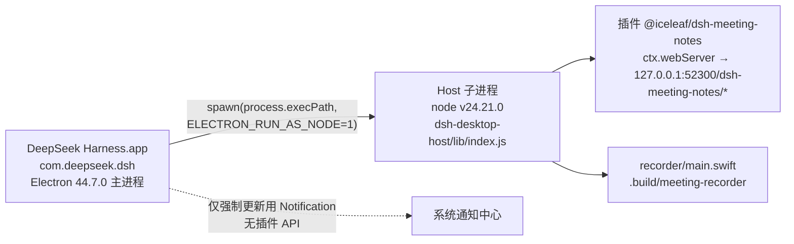
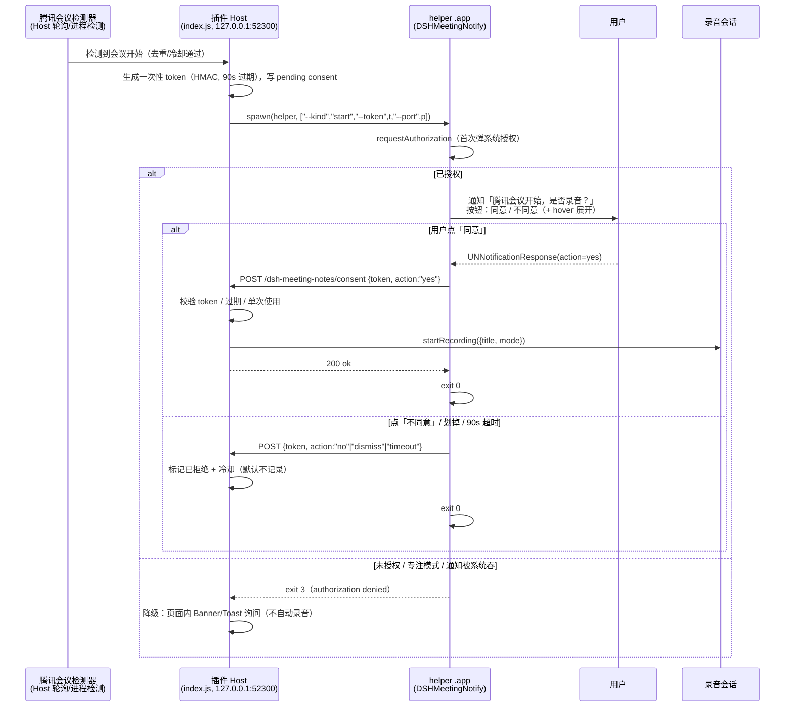

# macOS 可交互系统通知调研（腾讯会议开始/结束 → 同意 / 不同意）

> 调研对象：`@iceleaf/dsh-meeting-notes` v0.2.1（DSH 插件），目标功能：腾讯会议开始或结束时弹**系统级通知**，带「同意 / 不同意」两个动作；点同意 → 调插件现有的开始/结束录音接口，点不同意 → 无动作。
>
> 调研时间：2026-11-11。测试机：macOS **26.6.2**（Build 25G83），arm64 Apple M2，DSH Desktop **0.2.2-rc.1**（Electron 44.7.0）。
>
> 标注约定：**✅ 已验证**（本机实测，含命令/输出证据）· **⚠️ 外部证据**（文档/issue，未在本机复现）· **❓ 未验证**（推断或未完成）
>
> 本次**未修改任何仓库代码**，实验产物在 `/tmp/nt-research/`。

---

## 0. 结论速览

| 问题 | 结论 |
| --- | --- |
| 插件 Host 能直接 `new Notification()` 吗？ | **不能**✅。Host 是 `ELECTRON_RUN_AS_NODE=1` 的 DSH 子进程，`require('electron')` → `MODULE_NOT_FOUND` |
| DSH 主进程的通知能力能给插件用吗？ | **不能**✅。主进程 `Notification` 只服务强制更新流程；preload 桥无通知通道；Host↔主进程 IPC 封闭（未知消息会判 `invalid IPC event` 并 kill host） |
| 插件能以「DeepSeek Harness」名义弹通知吗？ | **身份基础成立、通路未打通**✅/❓。Host 子进程 `[NSBundle mainBundle]` 就是 DSH（`com.deepseek.dsh`），但用 koffi 调 UserNotifications 的授权/回调链路未验证成功；且点击路由可能落到主进程 |
| 两个按钮能直接显示为「同意 / 不同意」吗？ | **横幅上不行**⚠️。macOS 原生通知只有第一个 action 作为按钮直接显示，其余折叠进 hover 后的「选项/更多」；Sun Valley 式双按钮在 macOS 不存在 |
| 退路「点通知 → 回到插件页面」可靠吗？ | **Desktop 可行、Web 折衷**⚠️/❓。渲染进程 HTML5 `Notification` 身份是 DSH，点击可回页面，但无按钮；浏览器（Web profile）身份是浏览器，action 需 hover「更多」 |
| 现在能落地的完整方案？ | **helper .app（或 terminal-notifier）弹通知 + 点击回调 Host 本地 HTTP**。代价：额外 .app、Developer ID 签名 + 公证、身份不是 DSH、系统设置多一个 App 条目 |

**一句话**：现有架构下，「DSH 身份 + 原生双按钮 + 可靠点击回调」三者**不能同时满足**；要么牺牲身份（helper 方案），要么牺牲按钮（渲染进程通知降级），要么推动上游 DSH 增加 `notify` 插件服务。

---

## 1. 架构事实（决定可行性的前提）

### 1.1 进程与身份



| 事实 | 证据 |
| --- | --- |
| Host 是 Electron 以 Node 模式 spawn 的子进程 | ✅ `/tmp/nt-research/asar/lib/main.js:9979` `spawn(this.node, ["--expose-internals", …, entry, …], { env: desktopNodeEnvironment(...), stdio: ["ignore","pipe","pipe","ipc"] })`；`desktopNodeEnvironment`（`main.js:9744-9753`）注入 `ELECTRON_RUN_AS_NODE: "1"` |
| Host 拿不到 Electron 模块 | ✅ `ELECTRON_RUN_AS_NODE=1 "/Applications/DeepSeek Harness.app/Contents/MacOS/DeepSeek Harness" -e 'require("electron")'` → `node v24.21.0 electron 44.7.0`，`require("electron")` → `MODULE_NOT_FOUND`；`Notification.isSupported()` 同样报错 |
| 主进程 Notification 只有一处 | ✅ `main.js:17672-17688`：`new Notification({ title: messages.mandatoryReady, body: messages.mandatoryNotification, silent: true })`，`once("click", … returnToConfirmation())` |
| 插件没有通知 API | ✅ 全包扫描 `notification/notify` 只命中 `lib/main.js`；`preload-app.cjs` 暴露 `dshOnboarding`/`dshDesktopBoot`/`dshPlatform`/`dshDesktop`/`__DSH_LOCALE__` 等，无通知桥 |
| Host↔主进程 IPC 封闭，插件不能 `process.send` | ✅ 未知消息 → `this.fail(new Error("dsh desktop host sent an invalid IPC event")); child.kill("SIGTERM")` |
| Host 进程的 bundle 身份就是 DSH | ✅ koffi 调 objc：`[NSBundle mainBundle] bundleIdentifier` = `com.deepseek.dsh`，`bundlePath` = `/Applications/DeepSeek Harness.app` |
| `UNUserNotificationCenter` 在 Host 里可获取 | ✅ `[UNUserNotificationCenter currentNotificationCenter]` 返回 `<UNUserNotificationCenter: 0x128003a6240>`，不崩溃 |
| DSH 当前通知授权状态 | ✅ `~/Library/Preferences/com.apple.ncprefs.plist` 无 `com.deepseek.dsh` 条目 → **notDetermined**（从未请求过） |
| DSH 的 Info.plist 缺按钮生效键 | ✅ `/Applications/DeepSeek Harness.app/Contents/Info.plist` 无 `NSUserNotificationAlertStyle`；`codesign -dv` 显示 `Identifier=com.deepseek.dsh`、`TeamIdentifier=NAN929V4UM`、hardened runtime、6162 个 sealed 文件 |

### 1.2 与「按钮」相关的硬约束

- **⚠️ Electron 官方文档**（[Notification](https://www.electronjs.org/docs/latest/api/notification)、[NotificationAction](https://www.electronjs.org/docs/latest/api/structures/notification-action)）：
  - macOS 上 `Notification` 底层是 UNNotification，**要求 app 已 code-signed**，未签名在 `show()` 时触发 `failed` 事件；
  - action `button`：**macOS 只把第一个作为主按钮直接显示，其余是 additional actions，需要 hover 才显示**；
  - macOS 按钮生效门槛：**已签名 + `Info.plist` 里 `NSUserNotificationAlertStyle=alert`**（DSH 当前缺此键，即使上游想加按钮也要先补）；
  - 多按钮与 `hasReply` 不兼容。
- **⚠️ Apple 设计事实**：macOS 通知横幅上没有并排的两个按钮；「同意/不同意」这类二选一要么放进 action 列表（hover 展开），要么用 alert 样式 + 第一个按钮 + 展开菜单。
- **✅ 实测**：`terminal-notifier` v3 自述与 Electron 文档一致——单个 `-action` 显示为按钮，多个时折叠为 Options 菜单（hover 才出现）。

---

## 2. 方案对比表

| # | 方案 | 横幅显示身份 | 双动作按钮 | 点击回调 | 权限 / 签名 / 分发 | macOS 26 可用性 |
| --- | --- | --- | --- | --- | --- | --- |
| a1 | **Electron 主进程 `new Notification`** | DeepSeek Harness | 需 `NSUserNotificationAlertStyle=alert`，且第二个起要 hover | 主进程 `click`/`action` 事件 → 需 IPC 给 Host | 已签名；需改 DSH 上游代码 | **不可用**（插件无通路）✅ |
| a2 | **helper .app + UNUserNotificationCenter**（打包成 .app，常驻/短驻） | helper 自己的名字（如 `DSH Meeting Notes`） | 可（UN category + `UNNotificationAction`），但 macOS 同样折叠第二个 | helper 的 `UNUserNotificationCenterDelegate` 收 `UNNotificationResponse` → HTTP POST / URL scheme 回 Host | **必须 Developer ID 签名 + 公证**；ad-hoc 在本机无法注册授权；需首次用户授权 | ✅ 机制成立（业界通行）；本机 ad-hoc 实测失败 |
| a3 | **koffi 直接在 Host 进程调 UNUserNotificationCenter**（借 DSH 身份） | DeepSeek Harness（理论上） | 可（需构造 UNMutableNotificationContent/category，全手写 objc 调用） | 需主机进程有 `NSApplication` 主 runloop 持有 delegate 才能收 response → 与 Node 事件循环冲突；且点击可能投给 DSH 主进程 | 依赖 DSH 已签名（✅）；需 TCC 授权弹窗 | **待定/高风险** ❓ |
| b | **terminal-notifier 3.1.0** | `terminal-notifier`（v3 已移除 `-sender`，不能伪造成 DSH） | 可（`-actions "同意,不同意"`，多动作折叠） | 进程常驻，stdout 打印被点按钮标题 / `@ACTIONCLICKED` / `@CLOSED` / `@TIMEOUT`；另有 `-execute CMD` / `-open URL` / `-activate ID`（结果只写系统日志） | 以 .app 分发（brew/自编译不带 quarantine）；ad-hoc 签名；未公证 | **待验证** ❓：本机 exit 3 "Notifications are not allowed for this application"；外部 issue 指向签名，但我们签名已有效仍失败，疑本机环境 |
| c | **osascript `display notification`** | Script Editor（实测归属它） | ❌ 无按钮 | ❌ 无点击事件 | 无额外权限（自动化权限视场景） | **✅ 横幅可用**（实测弹出），但能力不足 |
| c2 | **osascript `display dialog`** | 无（不是通知） | ✅ 真按钮 | ✅ 返回值 `button returned:同意` | 无 | ✅ 可用，但**阻塞脚本、抢焦点、模态**，不符合「系统通知」要求 |
| d | **Electron 渲染进程 HTML5 `new Notification()`** | DeepSeek Harness（由主进程以 app 身份提交） | ❌ Electron 的 HTML5 实现无 actions | ✅ `onclick` 回页面 → 前端调 Host HTTP 或 IPC | 共用 DSH 授权（首次系统弹「DeepSeek Harness 想发送通知」） | ⚠️❓ 机制推断成立，未在 DSH 内实测 |
| e | **浏览器 Web Notification / Service Worker**（Web profile） | 浏览器（Chrome / Safari） | ⚠️ 有 `actions`，但 macOS Chrome 上**不显示为按钮**，要 hover →「更多」 | ✅ `notificationclick` → 打开页面 / fetch Host | 站点权限（`http://127.0.0.1` 是 secure context，可请求） | ⚠️ 可用但动作形态差（Chrome 59+ 起走系统通知，官方博客明确要求 hover「更多」） |
| f | **node-notifier** | 转发 terminal-notifier / osascript | 取决于底层 | `notification.on('click')`（需常驻进程） | 需自带 terminal-notifier 二进制或依赖 brew | ❓ 未验证（npm 查询被沙箱 EPERM 阻塞）；本质是 b 的壳 |
| f2 | **node-mac-notifier** | 原生模块（NSUserNotification 时代） | 老 API 多按钮 | 事件回调 | 原生编译 + 签名 | ❓ 大概率已死：legacy `NSUserNotification` 在 macOS 26 多按钮 API 已移除（✅ 实测 `setOtherButtonTitles:` 抛 unrecognized selector） |
| f3 | **alerter v26.5** | 默认 `Terminal.app`（`--sender` 可改，是否接受 `com.deepseek.dsh` 未验证） | ✅ `--actions "Deploy,Cancel"` | 进程常驻，返回值为选中 action | 需随包分发（notarized，macOS 13+）；未在本机安装（禁止 brew install） | ❓ 未验证；作者已因 Sequoia 静默丢弃问题把默认 sender 改成 `com.apple.Terminal` |

> 结论：能同时满足「双动作 + 点击回调 + 可分发」的只有 **a2 / b / f3** 这类**外部 helper 进程**；但它们都**不能显示 DSH 身份**（a3 是唯一身份正确但未打通的路）。

---

## 3. 各方案最小示例

### a2. helper .app + UNUserNotificationCenter（推荐落地形态）

`Info.plist`（关键项）：

```xml
<key>CFBundleIdentifier</key><string>com.iceleaf.dsh-meeting-notes.notify</string>
<key>CFBundleExecutable</key><string>DSHMeetingNotify</string>
<key>CFBundlePackageType</key><string>APPL</string>
<key>LSUIElement</key><true/>
<key>NSPrincipalClass</key><string>NSApplication</string>
<key>LSMinimumSystemVersion</key><string>13.0</string>
<key>NSUserNotificationAlertStyle</key><string>alert</string>
```

```swift
// main.swift —— 发通知 + 等用户点击
import Foundation
import UserNotifications

let yes = UNNotificationAction(identifier: "yes", title: "同意", options: [])
let no  = UNNotificationAction(identifier: "no",  title: "不同意", options: [])
let cat = UNNotificationCategory(identifier: "MEETING", actions: [yes, no],
                                 intentIdentifiers: [], options: [.customDismissAction])
let center = UNUserNotificationCenter.current()
center.setNotificationCategories([cat])
center.requestAuthorization(options: [.alert, .sound]) { granted, err in
    guard granted else { print("denied:\(String(describing: err))"); exit(3) }
    let c = UNMutableNotificationContent()
    c.title = "检测到腾讯会议"
    c.body = "开始录音并生成会议纪要？"
    c.categoryIdentifier = "MEETING"
    center.add(UNNotificationRequest(identifier: "meeting-start",
                                     content: c, trigger: nil))
}
// 点击后系统会重新拉起本 bundle 并调用 delegate 的 didReceive response
final class D: NSObject, UNUserNotificationCenterDelegate {
    func userNotificationCenter(_ c: UNUserNotificationCenter,
                                didReceive r: UNNotificationResponse,
                                withCompletionHandler done: @escaping () -> Void) {
        // actionIdentifier: "yes" / "no" / UNNotificationDismissActionIdentifier
        postToHost(action: r.actionIdentifier)   // ← 见 §5 回调设计
        done(); exit(0)
    }
}
let d = D(); center.delegate = d
RunLoop.main.run()
```

签名/分发（本机实测要点）：

```bash
# 开发期只能用 ad-hoc，但 macOS 26 不认（✅ 实测 error 1），发布必须 Developer ID + notarytool
codesign --force --deep --sign "Developer ID Application: …" --options runtime DSHMeetingNotify.app
xcrun notarytool submit DSHMeetingNotify.app.zip --keychain-profile … --wait
xcrun stapler staple DSHMeetingNotify.app
```

回调 Host 的三种方式：

| 方式 | 优点 | 缺点 |
| --- | --- | --- |
| helper 常驻 + 按钮点击后 `POST https://…/dsh-meeting-notes/consent`（127.0.0.1 + 一次性 token） | 简单、可超时控制 | helper 要活着；需处理 token 生命周期 |
| URL scheme `dsh-meeting-notes://consent?action=yes&t=…` | 无需常驻（但系统仍要拉 helper 收 response） | 需要在 Host 侧注册 scheme（DSH 主进程注册，插件做不到） |
| 直接调 Host 的本地 HTTP（同 1，但 helper 每次自己 POST） | 无中间状态 | 同上 |

### a3. koffi 在 Host 进程内直调（身份正确，未打通）

```js
// 概要：Host 子进程内（已验证可跑）
const koffi = require('koffi')                // ✅ 3.1.1，dsh-desktop-host 自带
const objc = koffi.load('/usr/lib/libobjc.A.dylib')
const msg = objc.func('id objc_msgSend(id, void*, ...)')  // 变参需按 ABI 包装
// 已验证：[NSBundle mainBundle] → com.deepseek.dsh；UNUserNotificationCenter.currentNotificationCenter 可获取
// 未打通：getNotificationSettingsWithCompletionHandler: 的 block 回调不执行（我的 block 字面量构造有缺陷）
```

未打通的证据与判断：

- ✅ `UNUserNotificationCenter.current()` 成功；`[NSApplication sharedApplication]` 成功；`CFRunLoopRunInMode(mode, 0.2, 0)` 正常返回 3。
- ❌ `getNotificationSettingsWithCompletionHandler:` 传入手工构造的 24 字节 block `{isa=__NSGlobalBlock__, flags=0x10000000, reserved, invoke}`，泵 CFRunLoop 4 秒后 completion 未执行（`authorizationStatus=null`）。
- ❌ 用 `[NSArray enumerateObjectsUsingBlock:]` 对**同一个** block 做自检：`invoked=0` → **是我的 block 构造手法问题**，不能据此判 UN 不可行。修复方向：补 block descriptor / `flags=0x50000000`，或改用原生编译的小 dylib 暴露真实 block，或把主循环交给独立进程。
- 结构性风险（即使 block 修好）：**同一 bundle id 有多个实例**（DSH 主进程 + helper），通知身份按 bundle 注册，action 点击很可能投给「活着的」主进程，而主进程未注册 UN delegate → 点击可能静默丢失；Node 主线程被 libuv 占用，`NSApplication.run` 与 HTTP server 难以共存。

### b. terminal-notifier（有现成二进制，身份受限）

```bash
terminal-notifier -title "检测到腾讯会议" -message "开始录音并生成纪要？" \
  -actions "同意,不同意" -timeout 90 -group dsh-meeting-notes
# 交互模式常驻，stdout：
#   同意 / 不同意          ← 用户点了哪个
#   @ACTIONCLICKED         ← 点了通知主体
#   @CLOSED                ← 划掉
#   @TIMEOUT               ← 超时（exit 6）
```

- ✅ 本机源码 `make app` 可构建（CLT/clang，无 Xcode；universal、ad-hoc 签名、`codesign --verify` 通过）。
- ❌ 本机发通知：`Could not request notification permission: Notifications are not allowed for this application`，exit 3。
- ⚠️ issue [#328](https://github.com/julienXX/terminal-notifier/issues/328)：Homebrew 的签名缺陷（`linker-signed ad-hoc` + `Info.plist=not bound`）会触发同样的 `UNErrorDomain error 1`，修复是重签 `--identifier`。我们自行编译的签名有效却仍失败 → 本机另有原因（测试环境 TCC/弹窗受限）。
- ⚠️ issue [#329](https://github.com/julienXX/terminal-notifier/issues/329)：**并发多个交互通知时，响应会投递到错误进程**（A→B→C 轮转），作者不修 → 架构上必须保证同一时刻只有**一个**待响应通知（`-group` 去重 + 单飞行）。
- 身份固定 `fr.julienxx.oss.terminal-notifier`。v3 help 明确写：`-sender ID  No longer supported. It worked by overriding this tool's own bundle identifier, which the UserNotifications framework does not permit.` → **UN 框架层面就不允许伪造发送方身份**，这是一条关键的机制性结论，不是 terminal-notifier 的偷懒。
- 其他回调参数（v3 仍支持）：`-execute COMMAND`（点击后跑 shell 命令）、`-open URL`（点击打开 URL）、`-activate ID`（点击激活指定 app）；三者的执行结果**只写系统日志**（`log show --predicate 'process == "terminal-notifier"'`），不回到 stdout。
- `-timeout` **默认无限等待**（实测文档口径），必须显式传值；超时打印 `@TIMEOUT` 并 exit 6。
- `-ignoreDnD` 仍在，但需 Apple 授权 entitlement，官方说明「usually a no-op」→ 免打扰下无法强投。

### c. osascript

```bash
osascript -e 'display notification "开始录音并生成纪要？" with title "腾讯会议" sound name "Glass"'
osascript -e 'display dialog "开始录音并生成纪要？" buttons {"不同意","同意"} default button "同意"'
```

- ✅ `display notification` 实测横幅真实弹出（`/tmp/nt-research/shot-11-osascript.png`），身份是 **Script Editor**，无按钮、无点击回调。
- ✅ `display dialog` 有真按钮、返回 `button returned:同意`，但它是**模态对话框**（抢焦点、阻塞、非通知中心条目），可用作「前台可见时的兜底确认」，不能当系统通知。

### d. 渲染进程 HTML5 Notification（Desktop 降级路）

```js
// 在 DSH 渲染进程（plugin client 侧）可用
const n = new Notification('检测到腾讯会议', { body: '点击回到会议纪要页面', tag: 'mn-meeting' });
n.onclick = () => { window.focus(); openMeetingPanel(); };
```

- 身份 = **DeepSeek Harness**（Electron 在 macOS 由主进程以 app 身份提交，✅ 机制与官方文档一致），权限共用 DSH 那一次授权（首次弹「DeepSeek Harness 想发送通知」）。
- ❌ Electron 渲染进程的 HTML5 Notification **不支持 actions**（没有 `actions` 字段实现），因此只能「点通知 → 打开页面」。
- ⚠️❓ 未在 DSH 内实测（插件难以注入渲染进程脚本做 POC），但这是 Electron 既有能力，风险低。

### e. 浏览器 Web Notification（Web profile）

```js
// Web profile 打开 http://127.0.0.1:52300 时
const reg = await navigator.serviceWorker.ready;
await Notification.requestPermission();
const n = await reg.showNotification('检测到腾讯会议', {
  body: '开始录音？',
  actions: [{ action: 'yes', title: '同意' }, { action: 'no', title: '不同意' }],
  tag: 'mn-meeting', requireInteraction: true,
});
// serviceworker: self.addEventListener('notificationclick', e => { clients.openWindow(...) })
```

- ⚠️⚠️ macOS Chrome 自 59 起用系统通知，**action 按钮不直接显示，必须 hover 后点「更多」**（Chrome for Developers《移至 macOS 上的原生通知系统》）。
- 身份是浏览器（Chrome/Safari），与 DSH 无关；页面关闭后需 SW 才能接收点击。

### f. npm 包现状

| 包 | 机制 | 状态 |
| --- | --- | --- |
| `node-notifier` | 包装 terminal-notifier / osascript | ❓ 未验证（npm 查询被沙箱 `EPERM ~/.npm/_cacache` 阻塞）；本质是 b 的壳，受同样限制 |
| `node-mac-notifier` | 原生模块 + legacy `NSUserNotification` | ❓ 大概率不可用：legacy 多按钮 API 在 macOS 26 已被移除（✅ 实测 `setOtherButtonTitles:` → `NSInvalidArgumentException: unrecognized selector`） |
| `alerter`（vjeantet） | Swift helper，`--actions` + `--sender` | ❓ v26.5（notarized、macOS 13+）；默认 sender 已改为 `com.apple.Terminal`（Sequoia 起 bundle id 不对应已安装 app 的通知被静默丢弃）；`--sender com.deepseek.dsh` 能否显示 DSH 未验证 |

---

## 4. 本机实测记录

环境：macOS 26.6.2 (25G83)，arm64，Node v24.21.0（DSH Electron 44.7.0）。测试代码与截图全部在 `/tmp/nt-research/`。

| # | 实验 | 命令 / 产物 | 结果 |
| --- | --- | --- | --- |
| 1 | 裸 CLI（无 bundle）调 UN | `/tmp/nt-research/bare/bareprobe` | ❌ 崩溃：`NSInternalInconsistencyException: bundleProxyForCurrentProcess is nil: mainBundle.bundleURL file:///tmp/nt-research/bare/`，exit 134 ✅ |
| 2 | ad-hoc 签名的探针 .app 直跑二进制 | `DSHNotifyProbe.app/Contents/MacOS/DSHNotifyProbe --post` | ❌ `requestAuthorization` 秒回 `granted=false`, `error="Notifications are not allowed for this application"`（`UNErrorDomain error 1`）；`getNotificationSettings` 为 `authorization=0/alertStyle=0/sound=0` ✅ |
| 3 | 经 LaunchServices 启动（`open`）同一 .app | `open -n -o log --stderr err --env PROBE_LOG=… /tmp/nt-research/probe/DSHNotifyProbe.app --args --post` | ❌ 同样 error 1，无授权弹窗；`ncprefs` 无该 bundle 记录 ✅ |
| 4 | 官方 terminal-notifier 3.1.0（源码 `make app`） | `terminal-notifier -diagnose` | ✅ 正常输出（authorization not requested yet / alert style none），签名有效 ✅ |
| 5 | terminal-notifier 发交互通知 | `-actions "同意,不同意" -timeout 90 -group dsh-tn-test` | ❌ `Could not request notification permission: Notifications are not allowed for this application`，exit 3 ✅ |
| 6 | osascript 通知 | `osascript -e 'display notification …'` | ✅ 横幅真实弹出，身份 Script Editor，无按钮（截图 `shot-11-osascript.png`）✅ |
| 7 | Host 进程身份（koffi） | `/tmp/nt-research/un-poc.js` | ✅ `bundleIdentifier=com.deepseek.dsh`、`bundlePath=/Applications/DeepSeek Harness.app`、`UNUserNotificationCenter` 可获取 ✅ |
| 8 | Host 进程内 UN 授权回调 | 同上 | ❓ block 回调未触发（自检 block 本身未被调用 → 手法缺陷，待修） |
| 9 | Host 进程内 legacy 通知 | `/tmp/nt-research/legacy-poc.js` | ❌ `setOtherButtonTitles:` unrecognized selector（macOS 26 已移除）；去掉后 `deliverNotification` 返回 true 但 6s 内无可见横幅 ✅ |

> **沙箱限制（影响可验证性，必须写进结论）**：本会话运行在受限沙箱里，`ps`、`log show`、`launchctl setenv/bootstrap`、写 `~/Library/*` 全部被拒；无法读取系统日志、无法给 .app 打 TCC 授权、无法把 helper 装到 `~/Applications`。因此「ad-hoc 签名在本机为何拿不到通知授权」只能给出外部解释（orca 在 macOS 26.3 报告 ad-hoc 构建被系统性拒绝，需 `codesign --force --deep --sign -` 且 Info.plist 不能在签名后被改动），**生产环境结论以 Developer ID 正式签名为准**。

---

## 5. 推荐架构

### 5.1 分层推荐

1. **首选（能改上游时）**：DSH 主进程暴露插件服务，如 `ctx.desktop.notify({ title, body, actions, onAction })`，主进程用 Electron `Notification` + `NotificationAction` 实现，插件注册回调。这是唯一同时满足「DSH 身份 + 原生通知 + 可靠回调」的路径。上游还需在 `Info.plist` 补 `NSUserNotificationAlertStyle=alert`，否则按钮不生效。
2. **次选（不改上游，本仓库内落地）**：打包一个 **helper .app**（Swift + UNUserNotificationCenter），Host 通过 `child_process.spawn` 启动它并传入一次性 token；用户在通知上点「同意/不同意」→ helper 收到 `UNNotificationResponse` → `POST http://127.0.0.1:<port>/dsh-meeting-notes/consent`。代价：Developer ID 签名 + 公证 + 增加约 1–2MB 分发物 + 系统设置里多一个 App、需用户首次授权。
3. **降级（零分发成本）**：渲染进程 HTML5 `Notification`（Desktop）或 Web Notification（Web profile），只做「点通知 → 回到插件面板确认」，无按钮。配合页面内 ConfirmDialog 完成真正的同意/不同意。
4. **不推荐**：osascript `display dialog`（阻塞、抢焦点、非通知）；legacy `NSUserNotification`（macOS 26 已废）；`terminal-notifier -sender`（v3 无效，身份不能改）。

### 5.2 推荐链路时序图（helper .app 方案）



### 5.3 回调安全设计（必须逐条落实）

| 设计点 | 要求 |
| --- | --- |
| 只监听本机 | `ctx.webServer` 路由已绑 `127.0.0.1`；不要 `0.0.0.0` |
| 认证 | 一次性 token（HMAC-SHA256，含 `meetingId + kind + exp`），**单次使用**，90s 过期；不使用长期密钥 |
| 方法/头 | 沿用现有 `POST` + `x-dsh-meeting-notes: 1`；`consent` 路由 `requireWrite` 之外**再校验 token** |
| Origin | 复用 `originAllowed`（缺 Origin 放行，但 helper 是无 Origin 的本地进程，需靠 token 兜底） |
| **默认不记录** | 未收到「同意」之前绝不 `startRecording`；超时 / 划掉 / 关闭 = 拒绝；不做「用户不在就自动开始」 |
| 幂等 | 同一 `meetingId + kind` 只允许一个 pending consent；重复通知用 `group`/`tag` 去重 |
| 冷却 | 同一会议开始事件 5 分钟内不重复弹；连续拒绝 2 次后本次会议不再弹 |
| 单飞行 | helper 全局只允许 1 个存活实例（对齐 terminal-notifier issue #329 的响应错投问题） |
| 权限被拒 / 专注模式 | helper 启动先查授权；拒绝 → exit 3，Host 降级到页面内提示；专注模式无法探测（⚠️ 无公开 API），只能依赖「超时 = 拒绝」 |
| 多显示器 / 免打扰 | 通知中心负责投递位置；免打扰下静默进入通知中心，用户回来仍可点 → 保留 90s 以上有效期（建议 5 分钟，超时按拒绝处理） |
| 日志 | helper 退出码 + 动作写入插件日志；不记录正文之外的用户数据 |

---

## 6. Desktop vs Web profile

| 维度 | Desktop（Electron，主场景） | Web（浏览器访问 `127.0.0.1:52300`） |
| --- | --- | --- |
| 谁能弹通知 | 渲染进程 HTML5 Notification（身份 DSH）；主进程 Electron Notification（插件无通路） | 浏览器 Notification / Service Worker（身份浏览器） |
| 双按钮 | ❌ HTML5 无 actions；主进程有但需上游 | ⚠️ 有 actions，但 macOS 要在「更多」里展开 |
| 点击回调 | `onclick` → 页面内回调，可靠 | `notificationclick` → 打开/聚焦页面；SW 需常驻 |
| 权限 | 共用 DSH 系统授权（一次） | 站点权限（127.0.0.1 是 secure context） |
| 页面关闭后 | 通知仍可点（点击唤起窗口） | 需 Service Worker 才能收点击 |

---

## 7. 风险清单

1. **身份风险**：helper 方案的通知显示 helper 名字（如「DSH Meeting Notes」），用户可能误以为是第三方；Koffi/UN 方案显示 DSH 但**未打通且可能抢走主进程点击**。
2. **签名/公证风险**：helper 必须 Developer ID 签名 + 公证，否则 macOS 26 直接拒绝注册通知（✅ ad-hoc 实测 error 1）。这会显著抬高发布成本（证书、notarytool、CI）。
3. **授权不可见风险**：授权被拒后系统不会报错，只是「没有横幅」；`add()` 仍成功、`getHistory()` 仍有记录，**没有公开 API 区分「显示了」与「被吞了」**（⚠️ 外部证据）→ 必须设计超时=拒绝。
4. **按钮形态风险**：macOS 不会并排显示两个按钮，第二个要 hover；若产品坚持「一眼两个按钮」，macOS 上做不到（只能改 alert 样式 + 单按钮，或降级为页面内确认）。
5. **点击错投风险**：同一 bundle id 多实例（helper + 主进程）时，UN 响应可能投给错误进程（⚠️ terminal-notifier issue #329 的直接证据）；用独立 bundle id 可规避，但就失去 DSH 身份。
6. **合规风险**：录会议音频涉及隐私，通知文案必须说明「开始录音」，且默认不记录；保持现有 `writeAllowed` 保护。
7. **升级风险**：DSH 版本升级可能改变 Host 启动方式/IPC；helper 方案只依赖 `ctx.webServer` 与 `child_process`，相对稳；koffi 方案依赖 objc 私有细节，极脆弱。

---

## 8. 未验证项 / 后续 POC 清单

| 项 | 建议动作 | 预期耗时 |
| --- | --- | --- |
| koffi 在 Host 内收 UN 授权回调 | 修 block 构造（补 descriptor、`flags=0x50000000`）或用原生小 dylib 暴露真实 block；再测 `requestAuthorization` 回调 | 0.5–1 天 |
| 同 bundle id 多实例的点击路由 | 两个进程都注册 UN delegate，实测点击落到谁 | 0.5 天（需真实签名环境） |
| 渲染进程 HTML5 Notification 在 DSH 内表现 | 在插件 client 侧加临时按钮触发 `new Notification()`，确认身份与点击 | 0.5 天 |
| terminal-notifier 在正式签名环境 | 用 Developer ID 签名的 helper 替换，验证 `-actions` 展示形态与 stdout | 0.5 天 |
| alerter `--sender com.deepseek.dsh` | 装 alerter（brew 或源码），验证是否显示 DSH、macOS 26 是否仍投递 | 0.5 天 |
| Chrome Web Notification actions | 在 Chrome 上实测 hover「更多」形态与 `notificationclick` | 2 小时 |

---

## 9. 参考

- Electron Notification 文档：https://www.electronjs.org/docs/latest/api/notification
- Electron NotificationAction：https://www.electronjs.org/docs/latest/api/structures/notification-action
- Chrome 原生通知（action 需 hover「更多」）：https://developer.chrome.com/blog/native-mac-os-notifications
- terminal-notifier：https://github.com/julienXX/terminal-notifier（issue #328 签名、#329 响应错投）
- alerter：https://github.com/vjeantet/alerter（默认 sender `com.apple.Terminal`，`--actions/--sender`）
- 本机实验产物：`/tmp/nt-research/`（`asar/` 解包、`probe/` 探针 .app、`tn-src/` terminal-notifier 源码、`shot-*.png` 截图、`un-poc.js`/`legacy-poc.js`/`koffi-test.js`）
