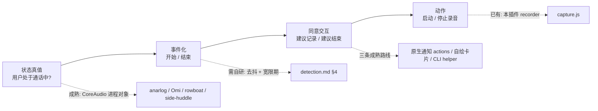
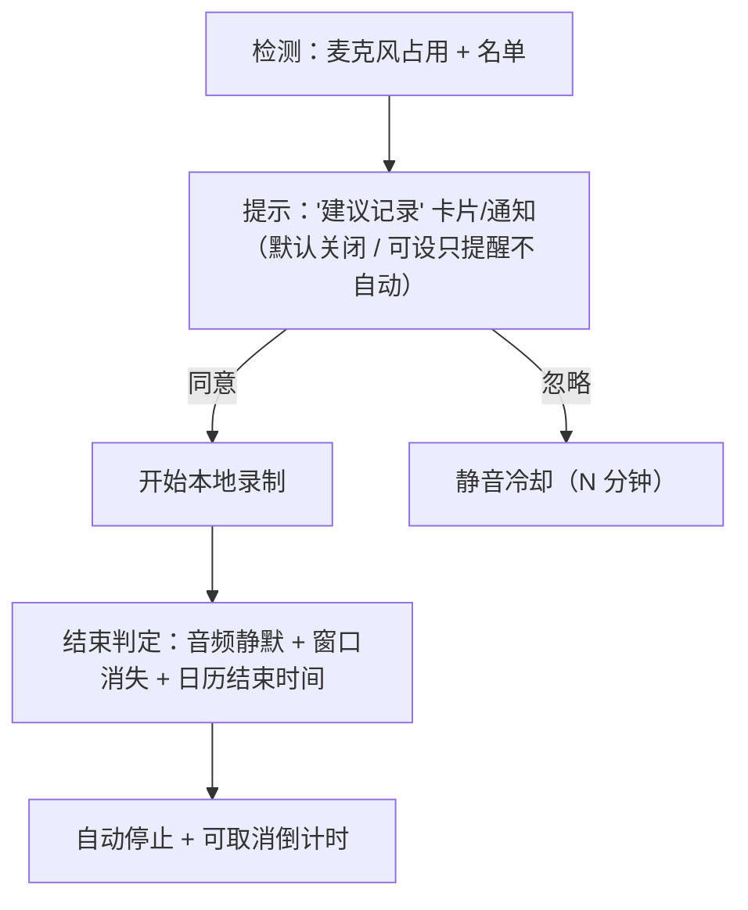

# 先例调研：腾讯会议检测 → 交互式通知 → 开始/结束记录

> 调研对象：新功能「检测腾讯会议（TencentMeeting.app）开始/结束 → 弹系统通知建议开始/结束记录 → 同意后触发 DSH 插件的录音」。
> 范围：只看外部先例与产品做法，本仓库不改代码。调研时间 2026-11-11，本机 macOS 26.6.2，腾讯会议 3.47.2。
> 配套文档：[docs/research/detection.md](./detection.md)（本机信号取证、窗口标题、xcast 日志、状态机参数）。本文不重复那部分，只回答"别人做过没有、能不能抄"。

---

## 0. 结论速览

| 问题 | 结论 | 证据强度 |
|---|---|---|
| 有没有项目检测「腾讯会议开始/结束」 | **没有**。GitHub 上的腾讯会议项目全是自动入会/摸鱼字幕/直播直链/屏幕共享，无一是会议状态检测；也没有任何 macOS 会议检测器把 `com.tencent.meeting` 写进名单 | 高（多组中英文搜索 + 代码搜索） |
| 有没有可借鉴的通用 macOS 会议检测 | **有，且不止一个**：anarlog（9.8k★）、screenpipe（22.3k★）、Omi、rowboat mic-monitor、side-huddle、Mostrom、GhrayInc、obsidian-meeting-detector。机制一致：**CoreAudio 进程对象 → 谁在占用麦克风 → 归因到 bundle id**，与会话软件无关，腾讯会议"免费"被覆盖 | 高（源码级） |
| 有没有「系统通知 + 同意/不同意 + 回调本地进程」的成熟实现 | **有，三种路线都有人做完**：UNUserNotificationCenter `UNNotificationAction` 双按钮（side-huddle 实做 `[🔴 Record] / [Skip]`）、CLI helper 等待并回传 stdout（terminal-notifier / alerter / node-notifier）、自绘浮窗卡片（anarlog / screenpipe / Granola） | 高（源码 + 官方 README） |
| 这条完整链路有人做过吗 | **没有以"腾讯会议"为对象的版本**；但最接近的 side-huddle 与 anarlog 在架构上与本方案同构（检测→建议→同意→本地录音）。缺口只剩「腾讯会议真机参数标定」和「DSH 插件内能否直接发 Electron 通知」 | 中（推理，需 POC） |

**一句话判断**：不要把需求理解成"检测腾讯会议"，那是把实现绑定在一个随时会变的客户端上。真实需求是"**用户此刻是否在通话中**"——麦克风占用是唯一的跨应用事实源；做成通用检测器，腾讯会议只是名单里的一行 bundle id，顺带覆盖飞书/Zoom/Teams。

---

## 1. 问题拆解（先想清楚再找先例）

链路里真正没有现成答案的只有 B（去抖参数）和 C 在 DSH 内的落地形态，其余都有成品可直接抄。

---

## 2. Q1：GitHub 上有没有「腾讯会议检测」

### 2.1 直接针对腾讯会议的项目：全部跑偏

| 仓库 | ★ | 做什么 | 与"检测开始/结束"的关系 |
|---|---|---|---|
| [jxlpzqc/TMSpeech](https://github.com/jxlpzqc/TMSpeech) | 1503 | Windows WASAPI loopback 实时字幕（"腾讯会议摸鱼工具"） | 无检测，需手动开关 |
| [xuwd1/wemeet-wayland-screenshare](https://github.com/xuwd1/wemeet-wayland-screenshare) | 497 | Linux Wayland 下腾讯会议屏幕共享 hook | 只 hook 屏幕共享，不涉会议状态 |
| [TencentCloud/tencentmeeting-cli](https://github.com/TencentCloud/tencentmeeting-cli) | 250 | 开放平台 OAuth2 CLI：会议管理、录制管理、参会报告 | **服务端 API，不能感知本机入会**；且需企业管理员授权 |
| [lilyomo/tencent_meeting](https://github.com/lilyomo/tencent_meeting) | 71 | 直播直链获取，用于录制直播 | 与会议生命周期无关 |
| [Yooooran/meetings-auto-participate](https://github.com/Yooooran/meetings-auto-participate) | 20 | 自动加入腾讯会议/Zoom | 检测的是"日程到点"，不是"已入会" |
| [elliottzheng/auto_wemeet](https://github.com/elliottzheng/auto_wemeet) | 17 | Windows 任务计划批量定时入会 | 同上，且 Windows only |
| [Tencent-Meeting/TencentMeetingSDK](https://github.com/Tencent-Meeting/TencentMeetingSDK) | 76 | 嵌入式会议 SDK 文档 | 只覆盖"把会议嵌进自己 App"的场景 |

**结论**：中文关键词「腾讯会议 自动录制 / 检测 / 提醒 / 纪要」、英文 `wemeet` / `TencentMeeting` 的组合搜索，都没有找到"检测腾讯会议是否在会中"的实现。**这个功能在开源世界里是空白**——既说明没有可直接抄的代码，也说明没有既成的错误范式要绕开。

### 2.2 通用 macOS 会议检测：机制可迁移，且已有人覆盖微信/飞书

| 项目 | ★ | 检测机制 | 可信度 | 可借鉴点 | 坑 |
|---|---|---|---|---|---|
| [fastrepl/anarlog](https://github.com/fastrepl/anarlog)（原 Hyprnote，"Open source Granola Alternative"，2026-11 仍在日更） | 9856 | [`crates/detect/src/lib.rs`](https://github.com/fastrepl/anarlog/blob/main/crates/detect/src/lib.rs) 暴露 `DetectEvent::MicStarted(Vec<InstalledApp>) / MicStopped / ZoomMuteStateChanged / SleepStateChanged`；mic 模块用 CoreAudio 进程对象 + `is_running_input` 归因到 `NSRunningApplication` 的 bundle id；另有 `meeting_ax`（Zoom 静音状态）、`screen`、`sleep` 等独立 feature | 高（工业级、活跃） | 检测能力做成 Cargo feature（mic/zoom/screen/sleep/list/app），**默认 mic 即可覆盖绝大多数会议**；事件模型就是"带上是谁"的数组，正好用来排除"自己在录音" | 依赖 macOS 14.2+ 与 swift-rs 桥；它的 `DetectEvent` 只有 Started/Stopped，结束去抖在上层策略里 |
| [mediar-ai/screenpipe](https://github.com/mediar-ai/screenpipe) | 22346 | 会议状态由后端 `MeetingStatusResponse` 给出，前端 `use-meeting-overlay.ts` 维护 activeMeeting/stoppableMeeting/meetingApp；`.github/workflows/eval-meeting-detection.yml` 说明他们给检测做了离线评测 | 高（大厂级） | **"检测"与"呈现"彻底解耦**：Rust 侧出状态，React 侧画卡片/浮层；有检测评测流水线（值得学：拿真会议样本回归） | 它是录屏+音频常驻产品，TCC 权限面比我们大 |
| [BasedHardware/omi](https://github.com/BasedHardware/omi) | 大/活跃 | [`ConferencingApps.swift`](https://github.com/BasedHardware/omi/blob/main/desktop/macos/Desktop/Sources/ConferencingApps.swift)：`nativeCallApps` 名单（Teams/Zoom/FaceTime/Webex/GoTo + Slack/Discord/WhatsApp/Telegram）+ **必须同时 `callAppIsUsingMicrophone()`** 才算会议；watch 型 `MeetingDetector.swift` 组合日历事件、去抖、`requestNoteTakingNotice()` 弹"是否记录"提示 | 高 | "**名单 + 麦克风占用**"双重门控是最佳实践：空闲的 Slack/腾讯会议窗口不会触发；`applyDetected/applySnapshot` 把"音频快照 + 日历"一起喂给状态机 | 名单里**没有腾讯会议**（也没飞书）——正是我们要补的那一行；它用 app 显示名匹配，改中文进程名会失效 |
| [rowboatlabs/rowboat](https://github.com/rowboatlabs/rowboat) | 大/活跃 | [`apps/x/apps/main/native/mic-monitor.swift`](https://github.com/rowboatlabs/rowboat/blob/main/apps/x/apps/main/native/mic-monitor.swift)：注释直写"ambient meeting-detection signal (Granola-style)"，per-process（macOS 14.4+）优先、设备级 `kAudioDevicePropertyDeviceIsRunningSomewhere` 兜底，输出 JSON lines，stdin 关闭即退出 | 高（代码短、注释把坑写全了） | **这就是我们 detector 的参考实现**：无需麦克风权限（读设备状态而非内容）、无归因时降级、helper 不脱离宿主进程 | 注释里的坑：**Electron 主进程在采音时 spawn 子进程会 EBADF**；浏览器会议只能归因到 Chrome helper |
| [kenotron-ms/side-huddle](https://github.com/kenotron-ms/side-huddle) | 0（新） | Rust 库 + macOS 菜单栏 App：检测 Teams/Zoom/Meet（`crates/side-huddle/src/platform/darwin/detect.rs`），三路录音，Whisper 本地转写；检测到会议后弹**带 `[🔴 Record]/[Skip]` 按钮的通知** | 中高（单人项目但完整跑通全链路） | **与本方案架构同构的最佳参照**：检测→建议→同意→录音→通知点击回调，全在菜单栏 App 内；通知类别注册与回调见 §3.2 | 只认 Teams/Zoom/Meet；`.dmg` 要求 macOS 14.2+ / Apple Silicon |
| [Mostrom-LLC/meeting-detector](https://github.com/Mostrom-LLC/meeting-detector) | 0 | 读 macOS TCC/media 日志（`meeting-detect.sh`）+ 进程归属 + 浏览器路由/标题启发式，输出 `meeting_started/changed/ended` 生命周期 | 低中（README 简略、未验证） | **生命周期事件命名**（started/changed/ended）比 started/stopped 更贴合真实会议；"changed"用于换会场景 | 依赖系统日志格式，跨 macOS 版本易碎；日志读取在生产上不可靠（`detection.md §2.7` 同结论） |
| [GhrayInc/MacMeetingAutoRecorder](https://github.com/GhrayInc/MacMeetingAutoRecorder) | 2 | Swift 菜单栏 App：进程检测 Zoom/Teams + 窗口标题检测浏览器 Google Meet，检测到后**弹提示询问是否录制**，会议结束自动停并询问保存 | 低（星少，代码可读） | "检测到 → 询问 → 录"的完整交互先例；结束用窗口/进程消失判定 | 窗口标题需屏幕录制权限；只覆盖三家 |
| [yut0takagi/obsidian-meeting-detector](https://github.com/yut0takagi/obsidian-meeting-detector) | 1 | Obsidian 插件：`pgrep` 检测 zoom.us/MSTeams + `osascript` 查浏览器标签；5s 轮询；**连续 3 次缺失（≈15s）才判结束**；osascript 超时算 unknown 不结束；检测到弹 modal/系统通知让用户选开始录音或建笔记 | 中（实现朴素但思路正） | **结束去抖参数**可直接借用：3 次确认 / 15s 宽限；**"查询失败不算结束"**这条规则很重要（抗网络抖动、抗切后台） | `osascript` 查标签需自动化权限，体验差；轮询粗糙 |

### 2.3 为什么"腾讯会议检测"没人做

1. 腾讯会议 macOS 客户端**没有本地事件接口**：无 AppleScript 字典（本机 `Contents/Resources/*.sdef` 不存在 [实测]），URL scheme 只有 `wemeet3` / `wemeet`（用于反向唤起、分享链接，**不能查询状态**）。
2. 官方能力只在服务端/嵌入端：会议事件订阅覆盖 Rooms/CSAPI，SDK 只覆盖"嵌进自己 App 的会议"（见 [腾讯会议事件订阅](https://meeting.tencent.com/support/topic/2021/)、[tencentmeetingsdk](https://github.com/tencent-meeting/tencentmeetingsdk)），二者都拿不到"本机某个人是否正开着客户端在会中"。
3. 国内同类产品（飞书妙记、腾讯会议自带录制）走的是"**自家会议内自动录制**"路线，根本不需要跨应用检测（见 §5），所以没有开源需求。
4. 结果：**检测这件事只能靠 OS 层旁路信号**，而 OS 层信号是通用的，所以先例都以"Zoom/Teams/Meet"命名——腾讯会议只是名单缺一行。

---

## 3. 关键补充：URL scheme / 日志 / 进程能不能当信号

| 信号 | 先例采用者 | 对腾讯会议是否可用 | 坑 |
|---|---|---|---|
| 进程名 / `NSRunningApplication` | GhrayInc、obsidian-meeting-detector、Mostrom | 可用但**无区分度**：腾讯会议常驻菜单栏，进程在≠在会中 | 只适合当"客户端是否启动"的粗筛，绝不能单独触发通知 |
| bundle id 名单 | LobsterAI（[`appCategories.ts`](https://github.com/netease-youdao/LobsterAI/blob/main/src/shared/desktopCompanion/appCategories.ts) 已把 `com.tencent.meeting` 归入 `C.Meeting`）、Omi | 可用，且是唯一稳定的身份锚点 | 名单要能容忍 helper 进程（浏览器会议归因到 `com.google.Chrome.helper` 之类） |
| **CoreAudio 进程对象 + `IsRunningInput`** | anarlog、Omi、rowboat、AFFiNE、OpenWhispr | **首选**：腾讯会议 `Info.plist` 自己写明 "Tencent Meeting will access your microphone when you start meetings or join meetings" [实测]，即"用麦"≈"在会中" | 静音/只收听时 input 是否保持 1 必须真机验证（`detection.md` V2）；要排除自身 recorder，否则自激 |
| 窗口存在性 / 标题 | GhrayInc、obsidian-meeting-detector、detection.md §1.3 | 存在性无权限、标题需屏幕录制权限；能给出"会议名"用于文案 | 标题随版本变；入会预览窗口可能提前出现 |
| 客户端日志 | Mostrom（TCC 日志）、detection.md §1.4（`xcast_*.log`） | 有明文心跳可做诊断，**不建议做线上主信号** | 格式随版本变、路径依赖沙盒容器 |
| URL scheme | — | **不可用于检测**（单向唤起） | 只有 `wemeet://` 唤起，没有回调/查询 |
| 官方 webhook / SDK | tencentmeeting-cli、SDK | 不可用于"本机某人的会议" | 需企业授权，语义是"这个会议实体"而非"这个人" |

> 备注：本机已装腾讯会议 `CFBundleShortVersionString = 3.47.2`，bundle id `com.tencent.meeting`，`NSMicrophoneUsageDescription` 文案如上 [实测]。腾讯会议自身有"自动云录制"设置（[官方文档](https://meeting.tencent.com/support/topic/1546/)，客户端 3.17+），但那是它自己的云录制，**不会给外部进程任何事件**——这正是本插件的生态位：本地转写 + 本地纪要。

---

## 4. Q2：交互式系统通知（同意/不同意 + 回调本地进程）

### 4.1 三条路线总览

| 路线 | 代表实现 | 按钮能力 | 回调方式 | 对本项目的适配 |
|---|---|---|---|---|
| A. **原生通知 + actions**（UNUserNotificationCenter 或 Electron Notification） | side-huddle、terminal-notifier、alerter、node-notifier、Electron | 支持 1–N 个 action；**折叠态只显示 1 个按钮，其余收进 hover 后的菜单** | App 内 delegate / Electron `action` 事件 / CLI stdout | 交互最"系统"，但 UX 受 macOS 限制；DSH 已签名 Electron App，理论可直接发 |
| B. **自绘浮窗卡片** | anarlog（NSPanel）、screenpipe（React 卡片）、Granola（自家弹窗） | 任意按钮、任意布局、可带倒计时/进度 | 直接调本地函数 / IPC | UX 最好、可控，但要自己造窗口、处理全屏/多屏/焦点 |
| C. **CLI helper + stdout** | terminal-notifier、alerter、node-notifier | 同 A（本质还是原生通知） | 子进程打印结果，父进程读 stdout 并解析 | 最省事，但通知归属变成 helper 的 App（图标/权限/声音都是 helper 的） |

### 4.2 逐项证据与坑

**side-huddle（最贴近本需求，源码级）** — [cocoa_darwin.m](https://github.com/kenotron-ms/side-huddle/blob/main/cmd/side-huddle/cocoa_darwin.m)

- 注册 `UNNotificationCategory`，动作 `[🔴 Record]`（`UNNotificationActionOptionNone`）+ `[Skip]`（`UNNotificationActionOptionDestructive`），实现 `UNUserNotificationCenterDelegate` 的 `didReceiveNotificationResponse` 回调后直接把"开始录音"接上；另有 `[Open Folder]` 单按钮类别用于会后跳转。
- **最关键的坑（原文注释）**：`UNUserNotificationCenter` 在**裸二进制**里调用会崩溃——`mainBundle` 没有 bundle identifier。他们用 `sh_has_bundle()`（`[[NSBundle mainBundle] bundleIdentifier] != nil`）把每次通知调用都 guard 住。→ 结论：**必须跑在真正的 .app bundle 里**（DSH.app 满足；我们自己写 CLI helper 则不满足）。
- 它用 `NSApplicationActivationPolicyAccessory` + 菜单栏状态项，不占 Dock——与"插件常驻后台"的形态一致。
- 触发条件：检测到会议后立刻发通知（而非先询问 TCC），首次会顺带触发麦克风/屏幕录制授权弹窗。

**terminal-notifier（7.4k★，最常被抄的 CLI）** — [README](https://github.com/julienXX/terminal-notifier)

- 用法：`-action 'Yes,No'`（逗号分隔或重复 `-action`），**等待用户并在 stdout 打印被点的那一个**；配合 `-timeout` 到期打印 `@TIMEOUT` 并以退出码 6 结束。
- **按钮折叠是文档明写的行为**：单个 action 画成普通按钮；**给多个 action，macOS 会把它们折叠进 `Options` 菜单**；且"macOS reveals the button when you hover the notification or shows it immediately if you have set the style to Alerts"（需用户在系统设置里把该 App 通知样式设为 Alerts 才会常驻显示）。
- 退出码表：0 成功 / 1 用法错 / 2 参数错 / 3 未授权 / 4 连不上通知服务（常见于无 GUI session）/ 5 服务拒绝 / 6 超时。
- **身份坑**：通知图标永远来自发送它的 bundle，无法按条覆盖；想换图标只能做一个改了 bundle id 的副本 → 顺带在系统设置里多出一条独立的通知权限项。→ 同理，用 terminal-notifier 弹通知，用户看到的是"terminal-notifier"而不是"会议记录"。
- 需要 macOS 10.14+；`brew install terminal-notifier`。

**alerter（vjeantet）** — [README](https://github.com/vjeantet/alerter)

- 定位"**alert**"（常驻直到用户处理）而非 banner：Actions Alert / Reply Alert 两类；进程在用户交互或关闭时退出，把结果以纯文本或 **JSON** 打到 stdout（closed / timeout / replied / activated）。
- 需 **macOS 13+**；`brew install vjeantet/tap/alerter`；26.x 起用 SwiftPM 重写、双横线参数；支持自定义关闭按钮文案、**自定义 actions 下拉菜单文案**（=`Options` 那个折叠菜单的标题）、忽略勿扰、超时。
- 对本项目：如果一定要"CLI + 双按钮"，alerter 比 terminal-notifier 更合适（JSON 事件 + 常驻 alert + 可定制菜单标题）。

**node-notifier（5.8k★）** — [README](https://github.com/mikaelbr/node-notifier)

- macOS 后端就是**内置 vendored terminal-notifier 3.0.0**（universal binary），要求 macOS 10.14+；`options.actions` 支持字符串或数组，且"只有带 `actions`/`reply` 的通知会等待用户，其它直接返回"。
- 明确写着 `icon` 在 macOS 不支持（永远显示发送 App 的图标）、首次发通知会弹权限请求。
- 对本项目：**等于给 terminal-notifier 套一层 Node API**，但把 helper 塞进插件包会增加体积与签名负担；且 DSH 本身是 Electron，没必要绕 CLI。

**Electron Notification（DSH 自身就是 Electron）** — [官方文档](https://www.electronjs.org/docs/latest/api/notification)

- macOS 上底层就是 `UNNotification`；**文档明确：该 API 要求 App 已签名，未签名的二进制调用会触发 `failed` 事件、通知不出现**。
- 支持 `actions: [{ type: 'button', text: '…' }]` 与实例事件 `action`（带 `actionIndex`）、`click`、`close`、`failed`；`hasReply`/`reply` 支持输入框；`getHistory()`/`remove()`/`removeAll()`（macOS）可管理通知中心里的历史。
- 本机取证：`codesign -dv` 显示 DSH 为 `Developer ID Application: Hangzhou DeepSeek Artificial Intelligence Co., Ltd (NAN929V4UM)`，`Notarization Ticket=stapled`，`Identifier=com.deepseek.dsh`，版本 `0.2.2-rc.1` [实测] → **通知能发、且归于"DeepSeek Harness"**，这是相比 CLI helper 的明显优势（用户看到的发送者是对的，权限只需授权一次）。
- 待验证：插件跑在 cordis 的宿主（主进程）里，需确认 `import { Notification } from 'electron'` 在该加载路径可用（Electron 28+ 主进程支持 ESM）。这是 POC 第一件事。

**anarlog 自绘通知（B 路线的完成度标杆）** — [crates/notification-macos](https://github.com/fastrepl/anarlog/tree/main/crates/notification-macos)

- Swift 侧：`NotificationManager`（`NSApplication.shared` + `setActivationPolicy(.accessory)`）持有 `NSPanel`，`NotificationInstance` 维护 compact/expanded 两套内容视图、`ClickableView`、倒计时 timer 与超时进度条；文件按职责拆成 `NotificationManager+{CompactView,ExpandedView,Animation,Lifecycle,MouseTracking}.swift`。
- 回调契约（Rust 侧 `lib.rs`）：`rust_on_collapsed_confirm` / `rust_on_expanded_accept` / `rust_on_dismiss` / `rust_on_collapsed_timeout` / `rust_on_expanded_start_time_reached`，用 `swift-rs` 桥接，回调签名 `(key: String, tag: i32)`。
- **可借鉴的交互模型**：折叠态给一个"确认"按钮，展开态给完整信息 + "开始记录"；`expanded_start_time_reached` 说明他们把"到点自动开始"也做成了通知状态。这套模型比"两个原生按钮"信息量更大，也更适合"建议发起/结束记录"这种两段式提示。

**screenpipe 自绘卡片（Web 技术栈，与 DSH 前端最像）** — [meeting-join-notification.tsx](https://github.com/mediar-ai/screenpipe/blob/main/apps/screenpipe-app-tauri/components/meeting-join-notification.tsx)

- 一张 460×124 的卡片组件（`MEETING_JOIN_CARD_WIDTH/HEIGHT`），动作来自 `meetingJoinChoices` / `meetingOpenNoteChoices`：加入并记录 / 打开笔记 / 高清变体；`onMouseEnter/onMouseLeave` 控制停留；`busy` ref 防重复点击。
- [use-meeting-overlay.ts](https://github.com/mediar-ai/screenpipe/blob/main/apps/screenpipe-app-tauri/app/shortcut-reminder/use-meeting-overlay.ts) 维护 `activeMeetingId / stoppableMeetingId / meetingApp / stopping`，并通过 `status`/`snapshot` 消息与本地服务同步。**Tauri + React 与 DSH 插件 + Web 前端结构几乎一一对应**。

### 4.3 对本项目的适配建议（方案对比）

| 方案 | 实现 | UX | 成本 | 风险 | 建议 |
|---|---|---|---|---|---|
| A. DSH 主进程直接 `new Notification({ actions })` | 插件在 index.js 里 import electron | 系统通知，发送者=DeepSeek Harness；按钮需展开 | 低 | 插件加载路径能否拿到 electron；两个按钮在折叠态被收进 `Options`（macOS 行为） | **首选，先 POC 验证** |
| B. 插件 Web UI 内自绘卡片（见 `docs/research/detection.md §8` 的 Banner 方案） | client.js 拉 `/dsh-meeting-notes/detect` 轮询，弹页内卡片 | 可控、可带倒计时、可多按钮、免 hover | 中 | 用户不在 DSH 窗口时看不到 → 需要"系统通知点一下跳回页面"兜底 | **强烈建议与 A 并存**：系统通知负责"叫醒"，页内卡片负责"完整交互" |
| C. CLI helper（terminal-notifier/alerter）子进程 + stdout 回调 | 用 Node child_process 等待输出 | 系统通知，发送者=helper；图标/权限归属错 | 低 | 多一份 helper 体积与签名；未安装 brew 时不可用 | **兜底**，A 不可行时用 |

> 提醒：AGENTS.md 的交互规范里"一次性操作结果用 Toast、不可撤销操作用 ConfirmDialog"，与本功能不冲突——这是"外部事件建议"，警示级交互应走**通知/卡片**而不是常驻 Banner。

---

## 5. Q3：开源/商业会议笔记产品怎么触发"会议开始/结束"

| 产品 | 检测方式 | 触发交互 | 证据 | 可借鉴点 / 坑 |
|---|---|---|---|---|
| **Granola** | 日历（会议前 1 分钟）+ 用户打开笔记/点通知 | **自家右上角弹出窗口，明确不是 macOS 原生通知**；点它=打开会议 URL + 开始转写 | [notifications 帮助](https://docs.granola.ai/help-center/taking-notes/notifications)、[transcription 帮助](https://docs.granola.ai/help-center/taking-notes/transcription) | 不会自动转写、没有 meeting bot；"提醒"与"开始"解耦；文案是建议语气 |
| **Hyprnote / anarlog** | 麦克风占用（MicStarted/MicStopped）+ Zoom 静音状态 + 屏幕/睡眠 | 自绘 NSPanel 通知（折叠/展开），`expanded_accept` 回调开始记录 | [repo](https://github.com/fastrepl/anarlog)、`crates/detect`、`crates/notification-macos` | 与 Granola 同构的开源实现；检测/通知/录制三层解耦，最适合照抄架构 |
| **Meetily**（32.6k★，MIT） | 社区版无检测；Pro 版"看到每一路麦克风"，且**确认会议真的结束才停** | 入会自动开始/结束自动停止，**带可取消倒计时**，默认关闭 | [meetily Pro 1.9.2 release](https://meetily.ai/releases/pro/1.9.2)、[issue #218 "[FEATURE] Auto Record - Detect Meeting"](https://github.com/Zackriya-Solutions/meetily/issues/218) | **默认关闭 + 倒计时可取消**是降低"误触发反感"的关键设计；结束判定宁可保守 |
| **screenpipe**（22.3k★） | 后端会议状态 + 日历提醒 | 应用内卡片（join and take notes / open note）+ 会议浮层（含 stop 按钮、转录列表） | [meeting-join-notification.tsx](https://github.com/mediar-ai/screenpipe/blob/main/apps/screenpipe-app-tauri/components/meeting-join-notification.tsx) | "提示卡片"和"会中浮层"是两个不同的 UI 层，别混成一个 |
| **Otter.ai macOS App** | 桌面 App 内置会议检测（Zoom/Meet/Teams/Slack huddle…），可"提醒我记录"或"自动记录" | App 内提醒 | [Otter Notetaker 帮助](https://help.otter.ai/hc/en-us/articles/4425393298327-Otter-Notetaker-Overview)、第三方说明 [yaptotext](https://yaptotext.com/otter-ai-mac-app) | 同时保留"日历 bot 入会"与"本机 botless 录制"两条产品线，检测只服务于后者 |
| **Fireflies Desktop** | "auto-detects when a meeting starts and begins transcribing automatically"（Windows 10+/macOS 12+） | App 内指示器（"Fireflies indicator"告知参与者） | [fireflies desktop](https://fireflies.ai/desktop) | **透明度设计**：录制时给参会者可见提示，值得抄到我们的通知文案/图标 |
| **飞书妙记** | 不做跨应用检测：只在**飞书视频会议内**自动录制（管理员可设"会议自动录制/语音视频通话自动录制"，并有录制弹窗提醒） | 会议内自动开录 + 参会人弹窗提醒 | [飞书帮助：管理员会议设置](https://www.feishu.cn/hc/zh-CN/articles/360049067828)、[智能纪要](https://www.feishu.cn/hc/zh-CN/articles/244959839578) | 国内主流路线是"闭源生态内闭环"；他们的"录制提醒含语音"说明告知环节是刚需 |
| **腾讯会议自身** | 自动云录制/自动本地录制（设置→录制；客户端 3.17+；本地录制仅 Win/macOS 且需主持人电脑入会） | 会议内自动开录 | [官方：自动录制](https://meeting.tencent.com/support/topic/1546/) | **它已经在录了**——我们的差异点不是"录"，是"本地转写 + 一键纪要"；产品叙事应与它共存而非竞争 |
| **通义听悟 / 讯飞听见** | 未发现公开文档表明其做桌面跨应用检测（形态是网页/上传/移动端录音） | 上传或手动录 | — | 说明"跨应用自动检测"在国内不是标配，用户预期需要教育 |

### 5.1 这些产品的共性模式（可直接抄）

1. **默认不自动开始**（Meetily Pro 默认关闭、Granola 必须点、Otter 可配置）——误触发一次就永久关闭，这是产品生死线。
2. **提示文案是"建议"不是"已开始"**（Granola "start notes?"、Omi `requestNoteTakingNotice`、side-huddle `[Record]/[Skip]`）。
3. **结束判定比开始更保守**：Granola 三条件（转写静默 + 通话软件仍在用 + 日历结束时间）、Meetily "确认真的结束"、obsidian-meeting-detector 连续 3 次缺失才判结束、rowboat 记录 Granola 用 15 分钟静音阈值。→ 我们应采用 `detection.md §4.2` 的"宽限期 + 持续窗"，并在文案上写明"检测到会议可能已结束"。
4. **忽略后有冷却**（避免会议中途断流反复弹），且**用户手动开始/停止后要抑制自动建议**。

---

## 6. Q4：完整链路有没有人做过？

### 6.1 链路拆解与先例成熟度

| 环节 | 有没有人做过 | 最接近的先例 | 成熟度 |
|---|---|---|---|
| 检测"某种会议软件在会中" | 有，多套 | anarlog / Omi / rowboat / side-huddle | ★★★★☆ 可直接抄（机制） |
| 检测"**腾讯会议**在会中" | **没有公开实现** | LobsterAI 只做了 bundle id 分类（`com.tencent.meeting` → Meeting），无状态检测 | ★☆☆☆☆ 需真机标定参数 |
| 检测"会议结束" | 有，但都靠组合条件 | Granola 三条件、Meetily、obsidian-meeting-detector | ★★★☆☆ 参数需自己标 |
| 系统通知 + 2 按钮 + 回调 | 有 | side-huddle `[Record]/[Skip]`、terminal-notifier actions、alerter | ★★★★☆ 有坑（折叠/归属/签名） |
| 同意后触发本地录音 | 有 | side-huddle、GhrayInc、obsidian-meeting-detector | ★★★★☆ 我们的 recorder 已有 |
| **腾讯会议 + 双按钮通知 + DSH 录音（本方案）** | **没有人做过** | side-huddle 是最近似的同构实现（Teams/Zoom/Meet） | 缺口集中在"腾讯会议真机"与"DSH 插件内通知形态" |

### 6.2 明确结论

- **完整链路无先例**：全网没有"检测腾讯会议 → 弹同意通知 → 启动本地录音/纪要"的公开项目；腾讯会议生态的开源项目都在做"进会/录屏/字幕"，没有做"状态感知"。
- **每个环节都有成熟先例可借鉴**：
  - 检测机制 → anarlog 的 `DetectEvent::MicStarted`、Omi 的"名单 + 麦克风双门控"、rowboat 的 `mic-monitor.swift`（含降级与 Electron 坑注释）；
  - 结束时序与去抖 → Granola 三条件、Meetily 可取消倒计时、obsidian-meeting-detector 的 3 次/15s 规则；
  - 通知交互 → side-huddle 的双 action 实现与 `.app bundle` 坑、anarlog 的折叠/展开通知模型、Electron `actions` + `action` 事件；
  - 产品形态 → Granola 的"建议而非自动"、Meetily 的"默认关闭"、Fireflies 的"录制可见"。
- **最大空白（也是我们唯一必须自己做的）**：腾讯会议真机会中/结束的时序参数（静音时 input 是否保持、入会预览是否提前开麦、结束后音频流与窗口谁先消失）。这部分 [detection.md §7.3](./detection.md) 的 V1–V10 清单已经列好，只能靠真开会标定。

### 6.3 三个容易踩的坑（先例已经踩过）

1. **通知按钮在折叠态不可见**：macOS 只在 hover/展开或"Alert 样式"下露出 action；把"同意/不同意"都塞进原生通知，用户会以为只有一个按钮（terminal-notifier README 明写；Electron `actions` 同理）。
2. **通知身份与权限归属**：用 CLI helper 弹通知，发送者是 helper（图标、设置项、权限都是它的），用户容易当成流氓软件。DSH 已签名且 notarized，用主进程 Electron 通知可避免这个问题。
3. **自激与归因错误**：插件自己的 recorder 也占麦克风；浏览器版腾讯会议归因到 Chrome helper；腾讯会议的 helper/常驻进程会干扰"进程在=在会中"的朴素判断（参见 `detection.md §3.4`）。

---

## 7. 建议的 POC 顺序（最小验证，1–2 天）

1. **验证 Electron 通知可用性**：在插件 index.js 里 `import { Notification } from 'electron'`，发一条带 `actions: [{type:'button', text:'同意'},{type:'button', text:'忽略'}]` 的通知，听 `action` 事件；确认 DSH 主进程加载路径可行、通知归属为 DeepSeek Harness、权限弹窗只出现一次。
2. **真机标定腾讯会议**：加入一个真实会议，采样 `kAudioProcessPropertyIsRunningInput`（是否 1、静音/只收听时是否保持）、窗口集合差异、结束后时序（用 `detection.md` 的 `audio_procs.swift` / `probe_win.swift`）。
3. **接入通用 detector**：照 rowboat `mic-monitor.swift` 写常驻 helper（JSON lines + stdin 关闭退出），Node 侧状态机做宽限期；名单先放 `com.tencent.meeting` + 常用会议 App，排除自身 pid。
4. **UI 双通道**：系统通知（叫醒）+ 插件页内卡片（完整交互，含倒计时/取消）。
5. **默认关闭 + 首次引导**：默认仅"提醒"，自动开始作为高级开关；忽略后 10 分钟冷却；用户手动操作后抑制自动建议。

---

## 8. 参考链接

**检测机制**
- https://github.com/fastrepl/anarlog （`crates/detect`、`crates/notification-macos`）
- https://github.com/BasedHardware/omi/blob/main/desktop/macos/Desktop/Sources/ConferencingApps.swift
- https://github.com/BasedHardware/omi/blob/main/desktop/macos/Desktop/Sources/MeetingDetector.swift
- https://github.com/rowboatlabs/rowboat/blob/main/apps/x/apps/main/native/mic-monitor.swift
- https://github.com/kenotron-ms/side-huddle （`crates/side-huddle/src/platform/darwin/detect.rs`）
- https://github.com/Mostrom-LLC/meeting-detector
- https://github.com/GhrayInc/MacMeetingAutoRecorder
- https://github.com/yut0takagi/obsidian-meeting-detector
- https://github.com/qaid/meeting-minutes-autodetect
- https://github.com/netease-youdao/LobsterAI/blob/main/src/shared/desktopCompanion/appCategories.ts

**通知交互**
- https://github.com/kenotron-ms/side-huddle/blob/main/cmd/side-huddle/cocoa_darwin.m
- https://github.com/julienXX/terminal-notifier
- https://github.com/vjeantet/alerter
- https://github.com/mikaelbr/node-notifier
- https://www.electronjs.org/docs/latest/api/notification

**产品与文档**
- https://docs.granola.ai/help-center/taking-notes/notifications
- https://docs.granola.ai/help-center/taking-notes/transcription
- https://meetily.ai/releases/pro/1.9.2
- https://github.com/Zackriya-Solutions/meetily/issues/218
- https://fireflies.ai/desktop
- https://help.otter.ai/hc/en-us/articles/4425393298327-Otter-Notetaker-Overview
- https://www.feishu.cn/hc/zh-CN/articles/360049067828
- https://meeting.tencent.com/support/topic/1546/
- https://meeting.tencent.com/support/topic/2021/

**腾讯会议生态（反面证据：都在做别的）**
- https://github.com/jxlpzqc/TMSpeech
- https://github.com/xuwd1/wemeet-wayland-screenshare
- https://github.com/TencentCloud/tencentmeeting-cli
- https://github.com/Yooooran/meetings-auto-participate
